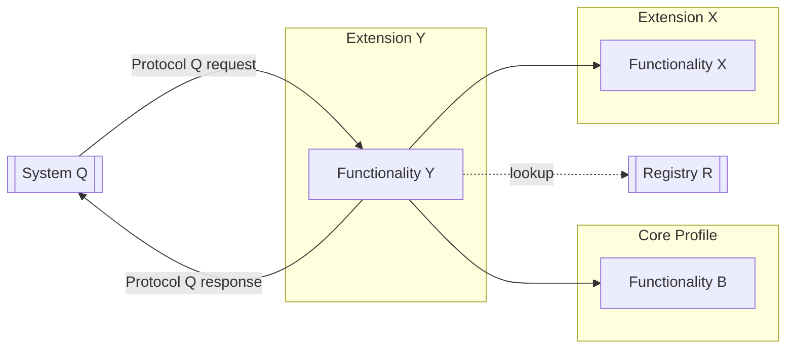


This chapter describes the mechanisms proposed in ARCH-ADR-7 (`ADR/ARCH-ADR-7.md`) for conformance profiles, and in ARCH-TDR-1 (`ADR/ARCH-TDR-1.md`) for capabilities. Neither has yet been decided by the Architecture Committee.


A Building Block specification is organised by functionalities, and each functionality realises one or more capabilities. Functionalities are grouped into **conformance profiles**: one **core** profile, which every conformant software solution meets, and **extension** profiles, which a software solution may claim in addition to the core. This chapter says what a capability, a functionality and a conformance profile are, how they are linked, and how a Working Group decides what goes into each profile.

# Capabilities

A capability is an outcome the Building Block makes possible for its beneficiaries: "Document Findability", "Payment Settlement", "Long-term Preservation". Capabilities are named in the *Purpose*, for a reader deciding whether the Building Block is relevant to them (`chapters/introductory_chapters.md`, *Value*).

A capability states **what**, never **how**. It names no product, vendor, protocol or technology, and it carries no requirements. Capabilities are informative: a software solution does not claim a capability and is not assessed against one. It is assessed against the functionalities that realise them.

Each capability is declared once, in `metadata.yml`:

```yaml
capabilities:
  - id: capability-a
    title: Capability A
    description: <one sentence: the outcome, from the point of view of the beneficiary>
  - id: capability-b
    title: Capability B
    description: <one sentence: the outcome, from the point of view of the beneficiary>
```

| Field | Content |
|---|---|
| `id` | A short identifier, unique in the specification and never reused |
| `title` | A noun phrase, used in the *Purpose* |
| `description` | One sentence: the outcome, from the point of view of the beneficiary |

## Capabilities and functionalities

Capabilities and functionalities answer different questions, for different readers, and are cut along different lines:

| | Capability | Functionality |
|---|---|---|
| Answers | What the Building Block makes possible | What a conformant software solution does, and for which actor |
| Written for | A decision-maker or buyer reading the *Purpose* | An implementer or assessor reading the requirements |
| Carries requirements | No | Yes, in its own file |
| Conformance profile | None. It follows from the functionalities that realise it | Exactly one: the profile whose folder holds its file |
| Declared in | `metadata.yml`, `capabilities` | Its own file in `conformance-profiles/<profile>/functionalities/` |

A functionality names the capabilities it realises in its `realises` field. The link is many-to-many. One capability is often realised by several functionalities, and these may sit in different conformance profiles: in the abstract example (`resources/abstract_example.md`), Functionality C (Core Profile) and Functionality Y (Extension Y) both realise Capability B. One functionality may also realise several capabilities: Functionality B realises both Capability A and Capability B.

A capability is therefore not a container for requirements. If it were, each requirement would belong to exactly one capability, and a capability that spans two conformance profiles would have to be split in two, along a line drawn for conformance rather than for value.

Rules:

1. Every capability is realised by at least one functionality.
2. Every functionality realises at least one capability. A functionality that realises none serves no outcome the *Purpose* names: either the *Purpose* is missing a capability, or the functionality belongs elsewhere.
3. A capability that at least one core functionality realises is provided by every conformant software solution. A capability that only extension functionalities realise is provided only by software solutions that claim one of those extensions, and the *Purpose* says so.
4. When the core and an extension both realise a capability, the *Technical Overview* says what a software solution that claims the extension provides beyond the core.

A Domain Reference Architecture has capabilities of its own, in its capability map, and maps each one to a Building Block in a role (`govstack-process/chapters/reference_architectures.md`, Part 3). That mapping may cite the capabilities of a Building Block specification by their ids. The relationship runs one way, as for conformance profiles: a Building Block's capabilities never reference a reference architecture.

# Functionalities

A functionality is a service the Building Block provides to an actor outside it, realised by a set of requirements. It is the unit a specification is organised by: each functionality has its own file in the `functionalities/` folder of the conformance profile it belongs to, and the functionalities named in that profile's introduction are those files, with the same names (`chapters/structure_of_specifications.md`).

This follows the "feature" organisation of requirements in ISO/IEC/IEEE 29148: a feature is a service the system provides externally, which may need a sequence of inputs to produce its result. A functionality is such a feature, and the sequence of inputs and responses that realises it is its workflow, described in the body of its file.

A functionality file holds:

| Part | Where | Content |
|---|---|---|
| Title | front matter, `title` | The name of the functionality, as in the introduction of its conformance profile |
| Description | front matter, `description` | What the functionality provides, from the point of view of the business. No requirements language. The *Functionalities* table of the profile's introduction repeats it |
| Realises | front matter, `realises` | The ids of the capabilities, declared in `metadata.yml`, that the functionality realises |
| Requirements | front matter, `requirements` | The requirements that realise the functionality |
| Body | below the front matter | Description, workflows and data structures. Free text that does not embed requirements |

A functionality file says nothing about its conformance profile. The folder it is in does.

A functionality is reached by an actor, directly or through another functionality. A functionality that no actor reaches is usually an internal mechanism, and may be better expressed as requirements of another functionality.

# Conformance profiles

A conformance profile is a named set of one or more functionalities that a software solution claims as a whole. Each profile has its own folder in `conformance-profiles/`, and the folder name, in kebab-case, is its id. The folder holds an `introduction.md` that declares and describes the profile, and a `functionalities/` folder with the files of its functionalities.

```mermaid
treeView
  conformance-profiles/
      core-profile/
          introduction.md
          functionalities/
              functionality-a.md
              functionality-b.md
              functionality-c.md
      extension-x/
          introduction.md
          functionalities/
              functionality-x.md
      extension-y/
          introduction.md
          functionalities/
              functionality-y.md
```

A profile has one of two types:

| Type | Meaning |
|---|---|
| `CORE` | Every conformant software solution meets this profile. A specification has exactly one |
| `EXTENSION` | A software solution meets this profile if it claims it, in addition to the core |

The profile is declared once, in the front matter of its `introduction.md`:

```yaml
---
title: Extension Y
type: EXTENSION # CORE, EXTENSION
description: <one sentence: what a software solution that claims it can do that the core alone cannot>
requires: [extension-x] # ids of other extension profiles this one depends on
role: Role B, towards Role Q # optional
reference_architecture: govstack:ra:example # optional
---
```

| Field | Content |
|---|---|
| `title` | The name used in the Technical Overview, the scope and GovMarket |
| `type` | `CORE` or `EXTENSION` |
| `description` | One sentence. For the core: what every conformant software solution can do. For an extension: what a software solution that claims it can do that the core alone cannot |
| `requires` | The ids of other extension profiles a software solution must also claim when it claims this one. Every extension adds to the core, so the core is never listed. Empty for the core |
| `role` | The role the Building Block performs through the profile, and towards whom. Optional when the profile serves no particular role |
| `reference_architecture` | The Domain Reference Architecture that describes that role. Optional |

The id is the folder name, and the functionalities are the files in `functionalities/`. Neither is repeated in the front matter, nor in `metadata.yml`.

## The core

The core is what makes a software solution an instance of the Building Block. A software solution that meets the core is a useful, conformant product on its own, even if it claims no extension.

The core of a specification is never empty, and never depends on an extension. A specification without extensions has a single conformance profile, of type `CORE`.

## Extensions

An extension adds to the core. It holds only what it adds, and does not repeat the core's functionalities. A software solution that claims an extension meets every `REQUIRED` requirement in it, as it does for the core. An extension is therefore all or nothing: a software solution cannot claim half of one.

Rules:

1. A functionality belongs to exactly one conformance profile: the one whose folder holds its file. Its requirements are not split between profiles.
2. An extension may add to the behaviour of a core functionality when it is claimed. It may not weaken or replace a core requirement.
3. An extension may require other extensions. The core never depends on an extension, and there are no cycles.
4. A variation point (ARCH-ADR-6) may sit in an extension. It then binds only the software solutions that claim the extension.
5. With ARCH-ADR-6, `applies_when` may name the id of an extension profile, so that a requirement in a core functionality applies only to software solutions that claim the extension. Use it when the requirement belongs in the core functionality by meaning, for example a requirement that core Functionality B records the identity of System Q for each exchange, which only a software solution that claims Extension Y has. Without ARCH-ADR-6, write such a requirement in a functionality of the extension.

## The introduction of a conformance profile

The `introduction.md` of a profile is the page a reader opens to decide whether to require the profile, and the page an assessor opens to plan its tests. It describes the profile only. An extension's introduction refers to the core's introduction for the core's actors and interfaces, and does not repeat them.

| Section | Required | Content |
|---|---|---|
| *Why choose this conformance profile?* | Yes | One or two paragraphs for a buyer: the need the profile meets, and what a software solution that meets it guarantees. For an extension, also say that a software solution that claims it meets the core |
| *Example use cases* | Yes | Three to six short scenarios from real services, each a bold title and one or two sentences |
| *Functionalities* | Yes | One row per functionality, followed by a functionality map |
| *Actors relevant for testing* | No | The actors an assessor needs to simulate or involve |
| *Interfaces* | No | The exchanges that cross the boundary of the Building Block through this profile |

### Functionalities

List the functionalities of the profile, one row each, in the order of `toc.yml`. The names match the file titles exactly and link to the files. The **Realises** column matches the `realises` field of each file, and the **Description** column repeats its `description` field. Columns that count the requirements of each functionality by level, with a total row, are optional; they help a buyer and an assessor see how much the profile asks.

| Functionality | Realises | Description |
|---|---|---|
| [Functionality Y](functionalities/functionality-y.md) | Capability B | <the `description` field of the file> |

Then draw a **functionality map**: the functionalities of the profile, the actors outside the Building Block that reach them, and how. For an extension, draw the core functionalities it builds on as a separate group, so that a reader sees where the extension attaches to the core. This is the diagram a reader returns to while reading the requirements.



*Figure: functionality map of Extension Y, with the functionalities of the core and of Extension X it builds on. Abstract.*

### Actors relevant for testing (optional)

Include an actor table when the functionality map alone does not make clear who the Building Block deals with through this profile, or where each actor's behaviour is specified.

| Actor | Kind | Role in tests | Functionalities | Specified where |
|---|---|---|---|---|
| System Q | System | Sends Protocol Q requests and checks the responses, as a conformant System Q would | Functionality Y | `govstack:ra:example` |
| Registry R | System | Answers lookups | Functionality Y | `govstack:ra:example` |

Guidance:

- **Specified where** names the publication that defines the actor's behaviour: a Domain Reference Architecture, another Building Block specification, an external standard, or "not specified". An actor outside the boundary is never specified by this document. Only its interface with the Building Block is
- Use the role names of the Domain Reference Architecture where one exists, so that readers can move between the two publications without translating
- Every actor outside the boundary reappears in **Not covered** in `scope.md`, with its owner
- An actor that appears only in an extension's table is one a software solution that claims only the core never deals with

### Interfaces (optional)

Include an interface table when a reader needs one place that lists every exchange crossing the boundary of the Building Block through this profile. Each requirement already records its interaction type in its `interaction` classifier (`chapters/requirements.md`), so the table is a summary of what the requirements say, not a second source of truth.

| Interface | Counterpart | Direction | Functionalities | Type | Contract defined in |
|---|---|---|---|---|---|
| Protocol Q | System Q | Inbound request, outbound response | Functionality Y | Protocol | `govstack:ra:example`, realised by `functionalities/functionality-y.md` |
| Registry lookup | Registry R | Outbound | Functionality Y | Consumed API | `govstack:ra:example` |

Types worth distinguishing:

| Type | Meaning | Contract usually lives in |
|---|---|---|
| Service API | An API this Building Block exposes for others to call | This specification, `resources/api.yml` |
| Consumed API | An API of another Building Block or system that this one calls | That Building Block's specification |
| Protocol | A multi-party exchange defined for a domain | A Domain Reference Architecture or an external standard |
| Event | A message published or subscribed to | This specification, or the publishing Building Block's |
| User interface | Interaction with a person | This specification, as far as it is specified at all |
| Device | Interaction with hardware, such as a card reader or biometric sensor | This specification, or an external standard |
| File | A file or data package read or produced in a defined format | This specification, or an external standard for the format |

Guidance:

- Every interface in the table is realised by at least one requirement of the profile, whose `interaction` classifier matches the type of the interface (`chapters/requirements.md`). An interface no requirement realises is either missing its requirement or does not belong in the table
- A protocol defined for a domain is usually realised by an extension, because it is an obligation towards a role that not every deployment has. If such an interface is realised by the core, explain in *Why choose this conformance profile?* why every conformant software solution needs it
- Interfaces every Building Block shares, such as logging, monitoring and deployment, are inherited from the cross-functional requirements and are not listed. List one only where this Building Block adds to the inherited contract
- Exchanges between deployments across a network go through an Information Mediator in the GovStack Architecture. Record the logical counterpart, not the mediator, unless the Building Block depends on a mediation feature specifically
- Name the contract, not the technology. Where a protocol is named, it is named in the requirement or in the reference architecture the table points to

# Deciding what is core and what is an extension

Start from the core. For each functionality, ask whether a product without it would still be an instance of the Building Block. If it would not, the functionality is core.

Put a functionality in an extension when one of these holds:

| Reason | Example |
|---|---|
| **Some conformant products legitimately lack it.** The capability adds to the Building Block, and a product without it still does the Building Block's job | A Payments Hub that does not issue vouchers |
| **It is an obligation towards a role in a domain.** The functionality exists to work with a counterpart that follows the protocol of a particular domain, and not every deployment has that counterpart | Functionality X: the exchange with System P through Protocol P, defined in a Domain Reference Architecture |
| **It depends on infrastructure that not every deployment has.** | Functionality Y: lookups in Registry R, which a country may not operate |

The second reason follows from how reference architectures work. A Domain Reference Architecture carries no requirements. The obligations a Building Block has towards a role in it belong in the Building Block specification (`govstack-process/chapters/reference_architectures.md`, Part 5). When those obligations are not part of what makes a software solution an instance of the Building Block, they are an extension. This keeps the Building Block autonomous: a software solution can conform to the core without any counterpart following a domain's protocol.

An extension names the role it serves and the reference architecture that describes the role, for the reader. Its requirements cite the standards they use directly, and are complete without the reference architecture. The relationship still runs one way: a reference architecture references the specification, never the reverse.

Group the extension functionalities into profiles by the reason a buyer would require them. Functionalities that a buyer always requires together belong in one extension; functionalities a buyer may require separately belong in separate ones.

## Other mechanisms, and when to use them instead

| The need | Use | Not an extension because |
|---|---|---|
| Every software solution does something, but may do it in one of several ways | A variation point with alternatives (ARCH-ADR-6) | The software solution cannot skip it |
| A behaviour improves quality and a software solution may skip it | A `RECOMMENDED` requirement | Nothing is claimed; GovMarket reports the share met |
| A whole specification is narrowed for one context, such as a country | A profile: a separate specification that extends this one | The narrowing is decided by someone other than the Working Group, for one context |
| The part can be assessed as a software component on its own | A separate Building Block specification | It does not need this Building Block's core |

## Warning signs

- **Every product would claim the extension.** It is core in disguise. Move its functionalities to the core's folder.
- **The extension has no `REQUIRED` requirement.** Claiming it guarantees nothing. Write its requirements as `RECOMMENDED` requirements in the core instead.
- **The core cannot stand alone.** A software solution that meets only the core would not be useful. A functionality the core needs has been placed in an extension.
- **The extension can be assessed without the core.** It may be a separate Building Block.
- **Extensions multiply with each combination.** Two extensions that differ only in how they do the same thing are a variation point inside one extension.
- **An extension's introduction repeats the core.** The extension holds only what it adds. Refer to the core's introduction instead.

# Conformance

- Every conformant software solution meets the core.
- A software solution declares the extensions it claims, in its conformance declaration. For each claimed extension, and each extension it requires, the software solution meets every `REQUIRED` requirement.
- The requirements of an extension that is not claimed are **not applicable**, neither passed nor failed. A `RECOMMENDED` requirement in an unclaimed extension is left out of the share GovMarket reports.
- GovMarket shows the claimed profiles as facts about the software solution, not as a score: "Example 1.0: Core Profile, Extension X, Extension Y". A buyer can filter on them, and cite them in a procurement.
- A conformance profile takes part in compliance through its `PUBLISHED` requirements (ARCH-ADR-5). An extension can be introduced with `DRAFT` requirements, so that implementations can experiment with it before it binds anything.

# Versioning

The requirements of a conformance profile follow the rules of *Versioning and Change Documentation*, judged against the software solutions that claim the profile. Changes to the profiles themselves are classified as follows:

| Change | Release | Reason |
|---|---|---|
| Adding an extension | minor | No existing claim changes |
| Moving a functionality from the core into an extension | major | Every citation of the specification loses a guarantee |
| Moving a functionality from an extension into the core | major | Every software solution gains obligations |
| Moving a functionality from one extension into another | major | Software solutions that claim either extension see their obligations change |
| Deprecating an extension | major | Software solutions that claim it lose their claim |
| Adding an extension to another one's `requires` | major | Software solutions that claim the first must now claim the second |
| Renaming a profile's folder | not allowed | The folder name is the id cited in conformance declarations. Change the `title` instead |

Moving a functionality between profiles is done by moving its file between folders. The change is recorded in the changelog like any other change of normative content.

Capabilities are informative. Adding, rewording or removing a capability, or changing the functionalities that realise it, is on its own a **patch** change: no software solution's conformance changes. A capability id is never reused, so a citation of a capability in a reference architecture never comes to mean something else.

# Terms that sound alike

| Term | Means | Unit |
|---|---|---|
| **extends** | One specification inherits another, and may tighten it. Every Building Block specification extends the cross-functional requirements | A whole specification |
| **Profile** | A separate specification that extends a Building Block specification and narrows it for one context, such as a national profile | A whole specification |
| **Conformance profile** | A named set of functionalities inside one Building Block specification, claimed as a whole: the core, or an extension | Functionalities |
| **Extension** | A conformance profile of type `EXTENSION`, which a software solution may claim in addition to the core | Functionalities |
| **Variation point** | A requirement a software solution meets by meeting some of its alternatives (ARCH-ADR-6) | A requirement |

Always write **conformance profile** in full, so that it is never read as a profile in the sense of a separate specification. Do not use "optional" for an extension. In GovStack usage, "optional" already means `RECOMMENDED`.

# Example

The abstract example in `resources/abstract_example.md` shows every rule of this chapter on one fictional Building Block:

| Conformance profile | Type | Functionalities | Realises | Requires |
|---|---|---|---|---|
| `core-profile` | `CORE` | Functionality A, Functionality B, Functionality C | `capability-a`, `capability-b` | |
| `extension-x` | `EXTENSION` | Functionality X | `capability-c` | |
| `extension-y` | `EXTENSION` | Functionality Y | `capability-b` | `extension-x` |

- Capabilities A and B are realised by core functionalities, so every conformant software solution provides them. Capability C is realised only by Extension X, so the *Purpose* says that only software solutions that claim Extension X provide it.
- Capability B spans the core and Extension Y, so the *Technical Overview* says what Functionality Y adds to what Functionality B and Functionality C provide.
- Extensions X and Y are extensions because they are obligations towards Role P and Role Q, which not every deployment has. Extension Y also depends on Registry R.
- A software solution that claims Extension Y also claims Extension X. One that does only what Functionality C does fails the core.

# References

- ARCH-ADR-5, *Separate a requirement's obligation level from its lifecycle status*
- ARCH-ADR-6 (proposed), *Model alternative and conditional requirements*
- ARCH-ADR-7 (proposed), *Organise a specification's functionalities into conformance profiles*
- ARCH-TDR-1 (proposed), *Declare capabilities and link functionalities to them*
- ISO/IEC/IEEE 29148:2018, *Systems and software engineering — Life cycle processes — Requirements engineering*
- OGC 08-131r3, *The Specification Model — A Standard for Modular Specifications*, Open Geospatial Consortium, 2009
