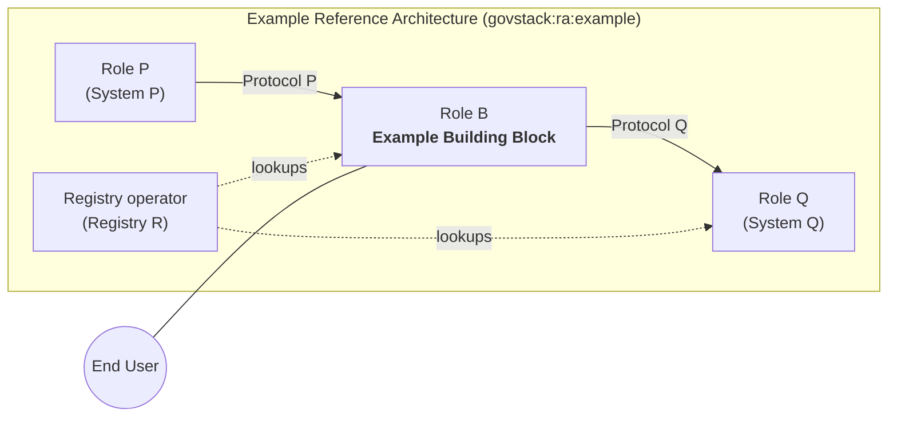

The `introduction/` directory of a Building Block specification opens the publication. It contains the following files:

| File | Answers |
|---|---|
|`purpose.md`|Why the Building Block exists|
| `scope.md` | What **this document** covers, and what it leaves to others |
| `technical_overview.md` | Why the specification is divided into these conformance profiles, what each is suited to, and what a conformance claim looks like |
|`terminology.yml`| A selection of terms that help explain key concepts on the Specification |
| `references.md` | List of sources the Working Group used as reference material for the specification. |

The `purpose.md` and the `scope.md` files are directed at a non-technical audience, specially decision-makers aiming to understand what a Specification does for them. The `technical_overview.md` file is directed at technical audiences, specially teams building or implementing a solution that fits the specification scope, for them to understand the conformance profiles available and choose the ones to meet. Each profile's own introduction, in `conformance-profiles/`, then describes its functionalities, actors and interfaces.

While the files are read in that order, the Working Groups often need to prepare them on a different one. For example, the scope is derived from the purpose and the technical overview, so it is written last. For this, see [Reading order and writing order](../resources/preparatory_work.md#reading-order-and-writing-order) in the Preparatory Work guide.

Below you will find explanations for each file, with examples. The examples describe an abstract Building Block, the Example Building Block, whose capabilities, conformance profiles, functionalities and roles are placeholders listed in `resources/abstract_example.md`. Replace them with the names of your own Building Block.


# Purpose

The `purpose.md` file is the first presentation of a Specification. It explains why this Building Block exists, the value it provides and the larger systems it interacts with.

Authors should think of it as Building Block pitch for a general audience. A reader who finishes the Purpose should know whether the Building Block addresses their need. The suggested subsections are as follows:

## Value

State the problem the Building Block solves, for whom, and what changes when it exists. Name the capabilities it provides as outcomes.

Answer four questions:

1. What problem does this Building Block solve, and for whom?
2. What can a government do with it that it could not do before?
3. Which capabilities does it provide?
4. What would go wrong if every government and vendor built this component to their own design?

Question 4 is the one specific to GovStack and a key one. Any government can build or buy software with the capabilities of question 3 without a GovStack specification. What a specification adds is an **agreement**: every conformant implementation offers the same functionalities through the same interfaces. Question 4 asks the Working Group to say why that agreement is worth having for this Building Block in particular, because the answer is what justifies the specification existing at all.

The answer usually takes one or more of these forms:

| Argument | What goes wrong without a common specification | Example |
|---|---|---|
| **Interoperability** | Parties that do not control each other's software must exchange information. Each pair negotiates its own integration, and the number of integrations grows with every new party | A record issued by one ministry cannot be checked by another agency unless both follow the same exchange |
| **Replaceability** | A government that changes supplier must rewrite every system that calls the old one, so in practice it never changes supplier | Replacing a messaging platform breaks every service that sends notifications through it |
| **Choice** | The party who selects the software is not the party who relies on it. Without a common specification, the one who relies on it must support every product the others might select | Each agency chooses its own product, and every service that relies on them must integrate with all of them |
| **Assurance** | A buyer cannot compare products, or a donor attach conditions to funding, without an agreed statement of what the component must do | A procurement can require conformance to a specification, and GovMarket can report it |

If none of these applies, the component may not need a GovStack specification: a Guide, or a contribution to a Domain Reference Architecture, may serve better.

Guidance:

- Name each capability with a **noun phrase**: "Document Findability", not "Finds documents"
- A capability states **what**, never **how**. Name no product, vendor, protocol or technology
- Declare each capability in `metadata.yml`, under `capabilities`, with the title used here (see `chapters/functionalities_and_extensions.md`, *Capabilities*)
- Every capability must be realised by at least one functionality, through the functionality's `realises` field. A capability nothing realises is either aspirational or misplaced
- When a capability is realised only by an extension, say so. A reader must not assume that every conformant software 
provides it
- Name the beneficiaries without describing their behaviour. Behaviour belongs to the actor tables of the conformance profiles
- One to three paragraphs. A long *Value* section is a symptom of an undecided scope

Skeleton:

```markdown
## Value

<Building Block> exists so that <beneficiary> can <outcome>.

Today <the problem, stated plainly>. <Building Block> provides <capability>, <capability> and
<capability>, so that <the changed state>.

A common specification matters here because <the interoperability, replaceability, choice or
assurance argument>.
```

## Place in larger systems

A Building Block is never the whole system. It is a component of a **Digital Service System**, and its value appears only when it works with other components. This section places the Building Block in the systems it operates in.

Describe:

- **The reference architectures it operates in.** Every Building Block operates within the GovStack Architecture, and inherits its cross-functional requirements. Name each **Domain Reference Architecture** in which the Building Block performs a role, and name the role. Where no Domain Reference Architecture exists for the domain, say so, and describe the domain context in the Building Block's own terms. That gap is worth reporting to the Architecture Working Group
- **Which part of the specification performs each role.** The obligations a Building Block has towards a role are in this specification, never in the reference architecture. When they are in an extension, say so: only a software solution that claims the extension performs the role in full
- **The other roles in those systems**, and which of them the Building Block exchanges information with. Name roles, not products: "Role P", not a vendor's platform that plays it
- **The Building Blocks it commonly works with**, and for what. A Building Block that sends messages, for example, is commonly invoked by a Workflow Building Block
- **Whether it is foundational or a feature Building Block**, when that helps the reader understand how much depends on it

The relationship runs one way. A Domain Reference Architecture references Building Block specifications; a Building Block specification does not depend on a Domain Reference Architecture to be complete. This section **places** the Building Block in the reference architecture for the reader. It does not import the reference architecture's content.

Include a **context diagram**: the Building Block as one role among the others in the system, with the main exchanges between them. Draw roles, not deployments, and keep the Building Block's internals out of it.



*Figure: the Example Building Block performs Role B in the Example Reference Architecture. Abstract.*

When the Building Block performs a role in more than one Domain Reference Architecture, draw one diagram per reference architecture rather than merging them.

# Scope

The scope specifies the boundary of the specification: what this document specifies, what conforms to it, and what it leaves to other parts of the process, whether they are other Building Blocks or not.

## Subject and applicability

Say what the document specifies, where the boundary of the Building Block sits, and what conforms to it, in the present tense and as statements of fact.

- **What the Building Block is**, in one or two sentences: "a software component that <does what>, on behalf of <whom>". The subject is a software component, never a government service, a person or an organisation
- **Where its boundary sits**: what is inside the component, and which neighbouring things are outside it even though they are closely related
- **How it is assessed**: as a black box, through its interfaces. When some requirements can only be verified by audit rather than by observation, say so in one sentence

The rest of the specification calls the software inside this boundary the *Building Block software*: it is what is assessed when a solution claims conformance. Do not describe the internal architecture of a solution: two conformant solutions may be built in entirely different ways.

```markdown
This document specifies the <name> Building Block, a software component that <what it is>.

Its boundary includes <what is inside>. It excludes <closely related things outside it>.

It is applicable to any software solution claiming conformance to <publication identifier>.
```

When the specification has extensions, add a conformance statement: what every conformant software solution meets, and what a software solution adds by claiming each extension.

```markdown
A conformant software solution meets the core of this document. It may also claim one or more of these
extensions, and meets every requirement of each extension it claims:

- <Extension>: <what it adds>. Requires <other extension>, if any.
```

## Relationships

State what the specification extends, and the reference architectures in which it performs a role.

```markdown
This document extends <cross-functional requirements identifier>. A conformant software solution meets the
requirements of both.

The <name> Building Block performs the <role> role in <Domain Reference Architecture identifier>.
```

The extension of the cross-functional requirements applies whether or not it is stated, but stating it costs one line and saves every reader from wondering.

## Covered

One entry per functionality, with the aspect of it that this document treats. Add the interfaces whose contract this document defines, if the functionality list does not already make them obvious. Group the entries under the core and each extension, in the order of the *Conformance profiles* table of the Technical Overview.

```markdown
### Covered

**Core Profile**

- Functionality A: <the aspect of it this document treats>
- Functionality B: <the aspect of it this document treats>
- Functionality C: <the aspect of it this document treats>

**Extension X**

- Functionality X: the Building Block's side of Protocol P, defined in govstack:ra:example

**Extension Y**

- Functionality Y: the Building Block's side of Protocol Q, defined in govstack:ra:example
```

An obligation towards a role that sits in an extension is **Covered**, under that extension. Only the counterpart's behaviour is **Not covered**.

## Not covered

Every excluded item names its owner. A bare list of exclusions describes gaps; an owner for each turns it into a boundary.

Record five kinds of item:

| Kind | Example | Usual owner |
|---|---|---|
| **Actors outside the boundary** | The behaviour of System P | The Domain Reference Architecture, or the counterpart's own specification |
| **Functionalities placed elsewhere** | Operating Registry R | Another Building Block specification, or a gap recorded in a Domain Reference Architecture |
| **Adjacent Building Blocks** | Identity proofing of the End User | The Identity Building Block specification |
| **Layers outside the technical one** | Who may act in Role P; the legal effect of an exchange | PAERA, a Guide, or the government adopting the specification |
| **Government services** | A service that relies on the Building Block's results | The country's Digital Service System. Not a GovStack publication |

```markdown
### Not covered

| Excluded | Owned by |
|---|---|
| Behaviour of System P and System Q | govstack:ra:example |
| Operation of Registry R | govstack:ra:example |
| Identity proofing of the End User | govstack:spec:bb:identity |
| Legal effect of an exchange | The adopting government |
```

Include an item only if a competent reader could plausibly have looked for it here. Listing things nobody expected reads as uncertainty. Do not list cross-functional concerns as excluded: they are inherited, and in force through the extension.

## Ownership

Name the Working Group that owns the specification, and where change requests go.

# Technical Overview

The `technical_overview.md` file identifies what a conformant software solution is, before the conformance profiles say what it must do. It is written for teams building, implementing or assessing a software solution, and it assumes the reader has read the Purpose and the Scope.

It explains the conformance profiles as a whole. What belongs to one profile, such as its functionalities, its functionality map, its actors and its interfaces, is in that profile's `introduction.md` (`chapters/functionalities_and_extensions.md`, *The introduction of a conformance profile*), and is not repeated here. The file has two sections: *Market assessment* and *Conformance profiles*.

## Market assessment

Explain what the Working Group surveyed before choosing the functionalities, and how the survey led to the conformance profiles. A reader who finishes this section knows why the specification asks for these functionalities and not others, and why they are grouped as they are.

Describe:

- **The state of the art**: the kinds of systems that already do what the Building Block does, in country implementations, open-source projects and products, and how mature the field is
- **The systems, standards and protocols examined**, and what each contributed. Naming protocols and standards is fine here. Describe products by category rather than by name, so that the specification stays vendor-neutral
- **Why the survey led to these conformance profiles**: what all the surveyed systems have in common became the core; what distinguishes a kind of system, and matters for interoperability, became an extension. Say what was considered and left out. Whatever was left out and has an owner reappears in **Not covered** in `scope.md`

The material comes from the *Groundwork reading* of the preparatory work (`resources/preparatory_work.md`). The sources the Working Group adopted or referenced are listed in `references.md`; this section explains what they taught the Working Group, not what they are.

Keep it short: one to four paragraphs, and a table of the kinds of system surveyed when there are more than a few. It sits directly before the *Conformance profiles*, which it justifies.

## Conformance profiles

List the conformance profiles in one table, the core first. Each profile has its own folder in `conformance-profiles/`, and the names here match the `title` in the front matter of each profile's `introduction.md`. Link each profile to its introduction.

| Conformance profile | Type | Functionalities | Requires | Suited to |
|---|---|---|---|---|
| [Core Profile](../conformance-profiles/core-profile/introduction.md) | Core | Functionality A, Functionality B, Functionality C | | Every conformant software solution: <what it can do on its own> |
| [Extension X](../conformance-profiles/extension-x/introduction.md) | Extension | Functionality X | | Software solutions that exchange with System P through Protocol P of `govstack:ra:example` |
| [Extension Y](../conformance-profiles/extension-y/introduction.md) | Extension | Functionality Y | Extension X | Software solutions that exchange with System Q through Protocol Q, where Registry R is operated |

Guidance:

- **Type** and **Requires** match the `type` and `requires` fields of each profile's front matter. **Functionalities** lists the files in its `functionalities/` folder, by title
- **Suited to** says which software solutions the profile is for. Write it for a buyer deciding whether to require the profile
- Explain the **core** first, and why it stands alone: what a software solution that meets only the core can do, and why that is enough to make it an instance of the Building Block
- Explain **why each extension is not core**: some conformant products legitimately lack it, it is an obligation towards a domain role that not every deployment has, or it depends on infrastructure that not every deployment has. When an extension serves a role, name the role and the Domain Reference Architecture that describes it
- A specification with a single conformance profile says so in one sentence, and skips the rest of this section

Add a small diagram of the profiles and how they depend on each other, when there are more than two. The functionality maps are in the profiles' introductions.

### What a conformance claim looks like

Show, for the kinds of system from the *Market assessment*, which conformance profiles each would claim, and which would fail the core and why. A buyer reads this to know what to ask for; a vendor reads it to know what to claim.

| Software solution | Claim |
|---|---|
| A kind of system that takes part in both exchanges of the domain | Example 1.0: Core Profile, Extension X, Extension Y |
| A kind of system that exchanges with System P only | Example 1.0: Core Profile, Extension X |
| A kind of system used without any counterpart of the domain | Example 1.0: Core Profile. No extension |
| A kind of system that exchanges with System Q only | Example 1.0: Core Profile. It cannot claim Extension Y without Extension X |
| A kind of system that does only what Functionality C does | Fails the core: it lacks Functionality A (requirement 3) |

Name kinds of system, never products. Cite the requirement a system fails on when it fails the core because of one.

### How the conformance profiles divide the capabilities

Show which functionalities of which profile realise each capability from the *Value* section of the Purpose. The table follows from the `realises` field of every functionality file.

| Capability | Core Profile | Extension X | Extension Y |
|---|---|---|---|
| Capability A | Functionality A, Functionality B | | |
| Capability B | Functionality B, Functionality C | | Functionality Y |
| Capability C | | Functionality X | |

Then, where a capability spans several profiles, say in a sentence what a software solution that claims the extension provides beyond the core. Name the capabilities that only extensions provide; the Purpose must say so too.

# Checks before publication

- [ ] The Purpose names at least one capability, and the capabilities it names are those declared in `metadata.yml`, with the same titles
- [ ] Every capability is realised by at least one functionality, and every functionality realises at least one capability. The **Realises** column of each profile's *Functionalities* table matches the `realises` field of each file
- [ ] A capability realised only by extension functionalities is said to be so in the Purpose
- [ ] The scope states what the Building Block is and where its boundary sits
- [ ] The Market assessment says what was surveyed and why it led to the conformance profiles listed
- [ ] Every conformance profile in the Technical Overview has a folder in `conformance-profiles/`, with the same title in the front matter of its `introduction.md`, and the same type and requirements
- [ ] Every functionality listed in a profile's introduction has a file in that profile's `functionalities/` folder, with the same name, and every file there is listed
- [ ] A software solution that meets only the core is a useful instance of the Building Block, and the Technical Overview says why
- [ ] Every extension has at least one `REQUIRED` requirement, and appears in the conformance statement and in **Covered** in `scope.md`
- [ ] When a profile's introduction has actor and interface tables, every actor in its functionality map appears in the actor table, and every arrow crossing the boundary appears in the interface table
- [ ] When an interface table is present, every interface is realised by at least one requirement of the profile
- [ ] Every actor outside the boundary, and every functionality placed elsewhere, appears in **Not covered** with an owner
- [ ] None of the three files contains a requirement, a product name or a vendor name

# Terminology

The `terminology.yml` file lists the terms this specification uses in a sense a reader might not assume, and the terms it shares with adjacent publications. It is not meant as a comprehensive glossary of the domain, but only as a reference for either key terms, or terms that a reader could misread due to competing definitions elsewhere.

How to choose terms, write definitions, take a definition from another publication or propose a term to the GovStack common terminology is covered in GovStack Terminologies `govstack:terminologies`. You can find guidance on how to collect the candidate terms during the preparatory work ([Terminology](../resources/preparatory_work.md#8-terminology)). This section only describes the file.

Each term is one entry:

```yaml
- entry:
    designation: Role B
    description: |
      <definition, following the rules in GovStack Terminologies>
    designated_at: govstack:ra:example
    urn: govstack:term:<id>
```

| Field | Holds |
|---|---|
| `designation` | The term, written exactly as the specification uses it |
| `description` | The definition, following the rules in GovStack Terminologies |
| `designated_at` | The identifier of the publication that defines the term: this specification, or the publication the definition is taken from |
| `urn` | The identifier of the term, as assigned under GovStack Terminologies |

Actor names, role names and functionality names are the terms most often shared with other publications. Where a Domain Reference Architecture or another specification already defines a term, point to it through `designated_at` rather than defining it again.

# References

The `references.md` file lists every external document the specification depends on, and the documents it points readers to. Its content comes from the *Groundwork reading* of the preparatory work ([Groundwork reading](../resources/preparatory_work.md#2-groundwork-reading)): list the sources marked **Adopt** or **Reference** there. Sources marked **Contrast** informed the work without being used, and belong in the *Market assessment* rather than here.

The file is plain Markdown: a `title` in the front matter, a second-level heading for each group of sources, and one bullet per source. Group the sources by topic when there are more than a few, and sort them alphabetically within each group. Write each entry as a bibliography entry in the style of the *Chicago Manual of Style*.

```markdown
---
title: References
---

## <Topic of the domain>

- GovStack. *<Title of a GovStack publication>*. Version <x.y>. govstack:<publication identifier>.
- <Standards body>. *<Title of the standard>*. <Reference and edition>. <Place>: <Publisher>, <year>.
- <Organisation>. *<Title of an online document>*. <Status>, <year>. <URL>.

## Requirements engineering

- International Organization for Standardization, International Electrotechnical Commission, and Institute of Electrical and Electronics Engineers. *Systems and Software Engineering — Life Cycle Processes — Requirements Engineering*. ISO/IEC/IEEE 29148:2018. Geneva: ISO, 2018.
```

Guidance:

- Cite a GovStack publication by its publication identifier, such as `govstack:spec:bb:example`, so that the reference resolves however the publication is hosted
- Give the version or edition of a document that changes over time. A requirement that depends on a standard depends on a particular edition of it
- Give a URL when the document is freely available online
- Do not list the cross-functional requirements or the GovStack Architecture only because every specification inherits them. List them when the text cites them
