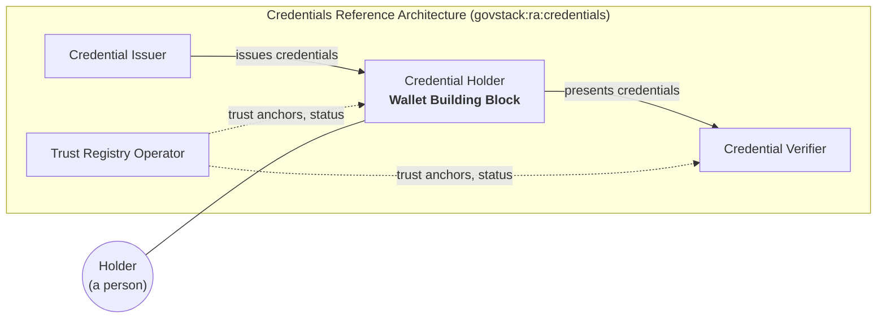
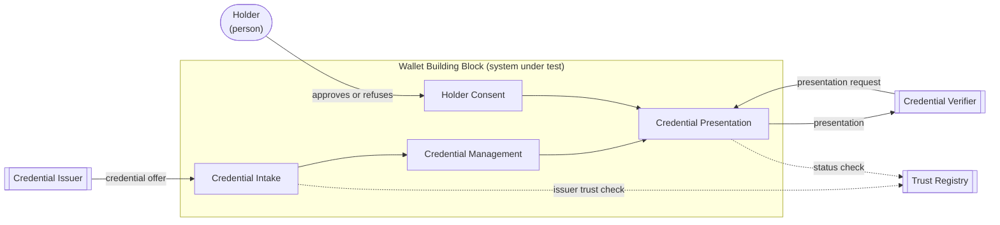

The `introduction/` directory of a Building Block specification opens the publication. Its two main
files work as a pair:

| File | Answers | Subject |
|---|---|---|
| `overview.md` | Why the Building Block exists (**Purpose**), and what it is (**Description**) | the Building Block |
| `scope.md` | What **this document** covers, and what it leaves to others | the document |

The overview describes. The scope delimits. Both are informative: neither contains a requirement.
An obligation stated in the introduction exists in two places, and the two will drift. Every
statement in the introduction that sounds like an obligation must have a requirement in
`requirements/` that carries it.

The content of both files comes from the Working Group's preparatory work
(`resources/preparatory_work.md`). The introduction publishes the result of that work; it does not
derive it. An introduction that cannot be filled usually means the preparatory work is incomplete.

The examples in this chapter are excerpts from a complete worked example for the Wallet Building
Block, in `resources/examples/wallet/introduction/overview.md` and `scope.md`. The examples are
illustrative: the Credentials Reference Architecture they cite is not yet published.

# Overview

The overview has two parts, in this order:

1. **Purpose**: why this Building Block exists, the value it provides and the larger systems it provides it
   in
2. **Description**: what it is, meaning the system under test, its functionalities, the actors around it and its
   interfaces

A reader who finishes the Purpose knows whether the Building Block is relevant to them. A reader who
finishes the Description knows what a conformant solution looks like from the outside, before reading a
single requirement.

## Purpose

### Value

State the problem the Building Block solves, for whom, and what changes when it exists. Name the
capabilities it provides as outcomes.

Answer four questions:

1. What problem does this Building Block solve, and for whom?
2. What can a government do with it that it could not do before?
3. Which capabilities does it provide?
4. What would go wrong if every government and vendor built this component to their own design?

Question 4 is the one specific to GovStack, and the one most often left unanswered. Any government
can build or buy software with the capabilities of question 3 without a GovStack specification.
What a specification adds is an **agreement**: every conformant implementation offers the same
functionalities through the same interfaces. Question 4 asks the Working Group to say why that
agreement is worth having for this Building Block in particular, because the answer is what
justifies the specification existing at all.

The answer usually takes one or more of these forms:

| Argument | What goes wrong without a common specification | Example |
|---|---|---|
| **Interoperability** | Parties that do not control each other's software must exchange information. Each pair negotiates its own integration, and the number of integrations grows with every new party | A credential issued by one ministry cannot be checked by a bank unless both follow the same exchange |
| **Replaceability** | A government that changes supplier must rewrite every system that calls the old one, so in practice it never changes supplier | Replacing a messaging platform breaks every service that sends notifications through it |
| **Choice** | The party who selects the software is not the party who relies on it. Without a common specification, the one who relies on it must support every product the others might select | A person chooses their own wallet, and every verifier must accept credentials from all of them |
| **Assurance** | A buyer cannot compare products, or a donor attach conditions to funding, without an agreed statement of what the component must do | A procurement can require conformance to a specification, and GovMarket can report it |

If none of these applies, the component may not need a GovStack specification: a Guide, or a
contribution to a Domain Reference Architecture, may serve better.

Guidance:

- Name each capability with a **noun phrase**: "Credential Storage", not "Stores credentials"
- A capability states **what**, never **how**. Name no product, vendor, protocol or technology
- Every capability must be realised by at least one functionality in the Description. A capability
  nothing realises is either aspirational or misplaced
- Name the beneficiaries without describing their behaviour. Behaviour belongs to the actor table
- One to three paragraphs. A long *Value* section is a symptom of an undecided scope

Skeleton:

```markdown
## Purpose

<Building Block> exists so that <beneficiary> can <outcome>.

Today <the problem, stated plainly>. <Building Block> provides <capability>, <capability> and
<capability>, so that <the changed state>.

A common specification matters here because <the interoperability, replaceability, choice or
assurance argument>.
```

### Place in larger systems

A Building Block is never the whole system. It is a component of a **Digital Service System**, and
its value appears only when it works with other components. This section places the Building Block
in the systems it operates in.

Describe:

- **The reference architectures it operates in.** Every Building Block operates within the GovStack
  Architecture, and inherits its cross-functional requirements. Name each **Domain Reference
  Architecture** in which the Building Block performs a role, and name the role. Where no Domain
  Reference Architecture exists for the domain, say so, and describe the domain context in the
  Building Block's own terms. That gap is worth reporting to the Architecture Working Group
- **The other roles in those systems**, and which of them the Building Block exchanges information
  with. Name roles, not products: "Credential Issuer", not a vendor's issuance platform
- **The Building Blocks it commonly works with**, and for what. A Building Block that sends
  messages, for example, is commonly invoked by a Workflow Building Block
- **Whether it is foundational or a feature Building Block**, when that helps the reader understand
  how much depends on it

The relationship runs one way. A Domain Reference Architecture references Building Block
specifications; a Building Block specification does not depend on a Domain Reference Architecture
to be complete. This section **places** the Building Block in the reference architecture for the
reader. It does not import the reference architecture's content.

Include a **context diagram**: the Building Block as one role among the others in the system, with
the main exchanges between them. Draw roles, not deployments, and keep the Building Block's
internals out of it.



*Figure: the Wallet Building Block performs the Credential Holder role in the Credentials Reference
Architecture. Illustrative.*

When the Building Block performs a role in more than one Domain Reference Architecture, draw one
diagram per reference architecture rather than merging them.

## Description

The Description identifies what a conformant solution is, before the requirements say what it must
do. It has four sections, and the diagrams and tables in them should agree with each other: every
actor in the functionality map appears in the actor table, and every arrow that crosses the
boundary appears in the interface table.

### System under test

State what is assessed when a solution claims conformance to this specification. The subject is a
software component, never a government service, a person or an organisation.

Describe:

- **What the system under test is**, in one or two sentences: "a software component that holds
  credentials on behalf of a person and presents them on request"
- **Where its boundary sits**: what is inside the component, and which neighbouring things are
  outside it even though they are closely related
- **How it is observed**: the Building Block is assessed as a black box, through its interfaces.
  Note anything that can only be verified by audit rather than by observation, since that affects
  how the requirements are classified

Do not describe the internal architecture of a solution. Two conformant solutions may be built in
entirely different ways.

### Functionalities

List the functionalities the specification is organised by, with one sentence each. Each
functionality has its own file in `requirements/`, and the names here match the file titles
exactly.

| Functionality | Description | Requirements |
|---|---|---|
| Credential Intake | Receiving a credential, recognising its format, and checking it before it is stored | `requirements/credential-intake.md` |
| Credential Management | Keeping, displaying, deleting, backing up and recovering credentials | `requirements/credential-management.md` |
| Holder Consent | Showing the Holder what is requested and recording their decision | `requirements/holder-consent.md` |
| Credential Presentation | Answering a Verifier's request with only the attributes the Holder agreed to disclose | `requirements/credential-presentation.md` |

Then explain **why these functionalities were chosen**: which capabilities from *Value* each one
realises, and which functionalities a reader might expect but that were placed elsewhere. The second
half of that explanation becomes the out-of-scope list in `scope.md`.

Include a **functionality map**: the functionalities inside the boundary of the system under test,
the actors outside it, and how each actor reaches each functionality. This is the diagram a reader
returns to while reading the requirements.



*Figure: functionality map of the Wallet Building Block. Illustrative.*

A functionality that no actor reaches, directly or through another functionality, is a sign that it
is an internal mechanism rather than a functionality, and may be better expressed as a requirement
of another one.

### Actors

List every actor the Building Block interacts with, and say for each whether it is inside or outside
the boundary of the system under test. Actors include people, organisations, other systems and
other Building Blocks.

| Actor | Kind | Boundary | Reaches the Building Block through | Specified where |
|---|---|---|---|---|
| Holder | Person | Outside | Holder Consent | Not specified: a person is not assessed. The user interface the Holder uses is specified here |
| Credential Issuer | System | Outside | Credential Intake | `govstack:ra:credentials` |
| Credential Verifier | System | Outside | Credential Presentation | `govstack:ra:credentials` |
| Trust Registry | System | Outside | Credential Intake, Credential Presentation | `govstack:ra:credentials` |

Guidance:

- **Specified where** names the publication that defines the actor's behaviour: a Domain Reference
  Architecture, another Building Block specification, an external standard, or "not specified".
  An actor outside the boundary is never specified by this document. Only its interface with the
  Building Block is
- Use the role names of the Domain Reference Architecture where one exists, so that readers can
  move between the two publications without translating
- Every actor marked *Outside* reappears in the out-of-scope list in `scope.md`, with its owner

### Interfaces

List every interface that crosses the boundary of the system under test: what passes across it, in
which direction, and where its contract is defined.

| Interface | Counterpart | Direction | Functionality | Type | Contract defined in |
|---|---|---|---|---|---|
| Credential issuance | Credential Issuer | Inbound | Credential Intake | Protocol | `govstack:ra:credentials`, realised by `requirements/credential-intake.md` |
| Presentation exchange | Credential Verifier | Inbound request, outbound response | Credential Presentation | Protocol | `govstack:ra:credentials`, realised by `requirements/credential-presentation.md` |
| Trust and status lookup | Trust Registry | Outbound | Credential Intake, Credential Presentation | Service | `govstack:ra:credentials` |
| Consent prompt | Holder | Outbound prompt, inbound decision | Holder Consent | User interface | This specification |

Types worth distinguishing:

| Type | Meaning | Contract usually lives in |
|---|---|---|
| Service API | An API this Building Block exposes for others to call | This specification, `resources/api.yml` |
| Consumed API | An API of another Building Block or system that this one calls | That Building Block's specification |
| Protocol | A multi-party exchange defined for a domain | A Domain Reference Architecture or an external standard |
| Event | A message published or subscribed to | This specification, or the publishing Building Block's |
| User interface | Interaction with a person | This specification, as far as it is specified at all |
| Device | Interaction with hardware, such as a card reader or biometric sensor | This specification, or an external standard |

Guidance:

- Every interface in this table is realised by at least one requirement. An interface no
  requirement realises is either missing its requirement or does not belong in the table
- Interfaces every Building Block shares, such as logging, monitoring and deployment, are inherited
  from the cross-functional requirements and are not listed. List one only where this Building Block
  adds to the inherited contract
- Exchanges between deployments across a network go through an Information Mediator in the GovStack
  Architecture. Record the logical counterpart, not the mediator, unless the Building Block depends
  on a mediation feature specifically
- Name the contract, not the technology. Where a protocol is named, it is named in the requirement
  or in the reference architecture the table points to

# Scope

The overview describes the Building Block. The scope turns that description into the boundary of
the document: what this document specifies, what conforms to it, and what it leaves to others.
Write it after the overview, because almost every statement in it is derived from one.

| Overview section | Becomes, in `scope.md` |
|---|---|
| *System under test* | The subject and applicability statements |
| *Place in larger systems* | The extension and relationship statements |
| *Functionalities* | The **Covered** list, one entry per functionality, with the same names |
| Functionalities considered and placed elsewhere | **Not covered** entries, with the owner of each |
| *Actors* marked *Outside* | **Not covered** entries, with the publication in **Specified where** as owner |
| *Interfaces* whose contract is defined elsewhere | **Covered**: this Building Block's side of the interface. **Not covered**: the counterpart's behaviour |

When the overview changes, review the scope against this table.

## Subject and applicability

Say what the document specifies and what conforms to it, in the present tense and as statements of
fact.

```markdown
This document specifies the <name> Building Block, a software component that <what it is, from
System under test>.

It is applicable to any software solution claiming conformance to <publication identifier>.
```

## Relationships

State what the specification extends, and the reference architectures in which it performs a role.

```markdown
This document extends <cross-functional requirements identifier>. A conformant solution meets the
requirements of both.

The <name> Building Block performs the <role> role in <Domain Reference Architecture identifier>.
```

The extension of the cross-functional requirements applies whether or not it is stated, but stating
it costs one line and saves every reader from wondering.

## Covered

One entry per functionality, with the aspect of it that this document treats. Add the interfaces
whose contract this document defines, if the functionality list does not already make them obvious.

```markdown
### Covered

- Credential Intake: receiving a credential and checking it before storage
- Credential Management: keeping, displaying, deleting, backing up and recovering credentials
- Holder Consent: presenting a request to the Holder and recording their decision
- Credential Presentation: answering a presentation request with only the consented attributes
```

## Not covered

Every excluded item names its owner. A bare list of exclusions describes gaps; an owner for each
turns it into a boundary.

Record five kinds of item:

| Kind | Example | Usual owner |
|---|---|---|
| **Actors outside the boundary** | The behaviour of a Credential Issuer | The Domain Reference Architecture, or the counterpart's own specification |
| **Functionalities placed elsewhere** | Operating a trust registry | Another Building Block specification, or a gap recorded in a Domain Reference Architecture |
| **Adjacent Building Blocks** | Identity proofing of the Holder | The Identity Building Block specification |
| **Layers outside the technical one** | Who may act as an Issuer; the legal effect of a presented credential | PAERA, a Guide, or the government adopting the specification |
| **Government services** | A licensing service that accepts presented credentials | The country's Digital Service System. Not a GovStack publication |

```markdown
### Not covered

| Excluded | Owned by |
|---|---|
| Behaviour of Credential Issuers and Verifiers | govstack:ra:credentials |
| Trust registry operation and admission | govstack:ra:credentials |
| Identity proofing of the Holder | govstack:spec:bb:identity |
| Legal effect of a presented credential | The adopting government |
```

Include an item only if a competent reader could plausibly have looked for it here. Listing things
nobody expected reads as uncertainty. Do not list cross-functional concerns as excluded: they are
inherited, and in force through the extension.

## Ownership

Name the Working Group that owns the specification, and where change requests go.

## Checks before publication

- [ ] The Purpose names at least one capability, and every capability is realised by a functionality
- [ ] Every functionality in the overview has a file in `requirements/`, with the same name
- [ ] Every actor in the functionality map appears in the actor table, and every arrow crossing the
  boundary appears in the interface table
- [ ] Every interface is realised by at least one requirement
- [ ] Every actor marked *Outside*, and every functionality placed elsewhere, appears in **Not
  covered** with an owner
- [ ] Neither file contains a requirement, a product name or a vendor name

# Terminology

# References
