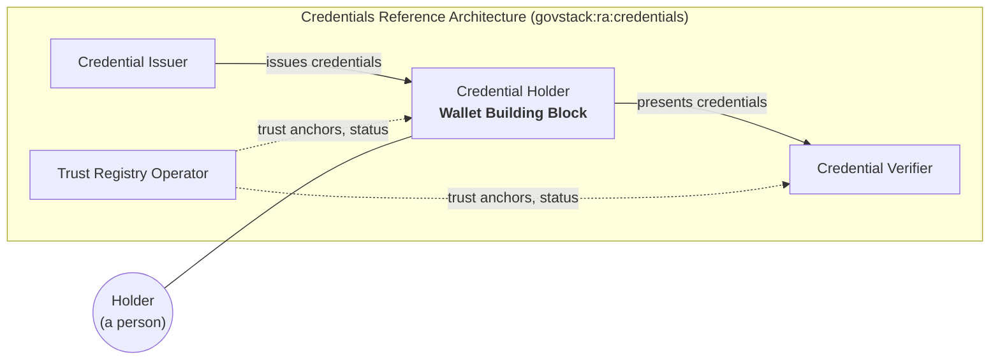
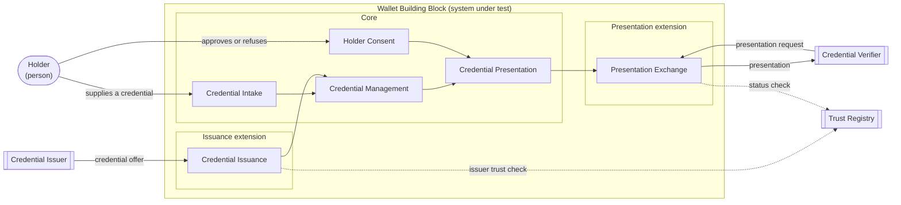

The `introduction/` directory of a Building Block specification opens the publication. Its two main files work as a pair:

| File | Answers | Subject |
|---|---|---|
| `overview.md` | Why the Building Block exists (**Purpose**), and what it is (**Description**) | the Building Block |
| `scope.md` | What **this document** covers, and what it leaves to others | the document |

The overview describes and the scope delimits. The content of both files comes from the Working Group's preparatory work (`resources/preparatory_work.md`). The introduction publishes the result of that work; it does not derive it. An introduction that cannot be filled usually means the preparatory work is incomplete.

The examples in this chapter are excerpts from a complete worked example for the Wallet Building Block, in `resources/examples/wallet/introduction/overview.md` and `scope.md`. The examples are illustrative: the Credentials Reference Architecture they cite is not yet published.

# Overview

The overview has two parts, in this order:

1. **Purpose**: why this Building Block exists, the value it provides and the larger systems it provides it in
2. **Description**: what it is, meaning the system under test, its functionalities and how they divide into a core and extensions, the actors around it and its interfaces

A reader who finishes the Purpose knows whether the Building Block is relevant to them. A reader who finishes the Description knows what a conformant solution looks like from the outside, before reading a single requirement.

## Purpose

### Value

State the problem the Building Block solves, for whom, and what changes when it exists. Name the capabilities it provides as outcomes.

Answer four questions:

1. What problem does this Building Block solve, and for whom?
2. What can a government do with it that it could not do before?
3. Which capabilities does it provide?
4. What would go wrong if every government and vendor built this component to their own design?

Question 4 is the one specific to GovStack, and the one most often left unanswered. Any government can build or buy software with the capabilities of question 3 without a GovStack specification. What a specification adds is an **agreement**: every conformant implementation offers the same functionalities through the same interfaces. Question 4 asks the Working Group to say why that agreement is worth having for this Building Block in particular, because the answer is what justifies the specification existing at all.

The answer usually takes one or more of these forms:

| Argument | What goes wrong without a common specification | Example |
|---|---|---|
| **Interoperability** | Parties that do not control each other's software must exchange information. Each pair negotiates its own integration, and the number of integrations grows with every new party | A credential issued by one ministry cannot be checked by a bank unless both follow the same exchange |
| **Replaceability** | A government that changes supplier must rewrite every system that calls the old one, so in practice it never changes supplier | Replacing a messaging platform breaks every service that sends notifications through it |
| **Choice** | The party who selects the software is not the party who relies on it. Without a common specification, the one who relies on it must support every product the others might select | A person chooses their own wallet, and every verifier must accept credentials from all of them |
| **Assurance** | A buyer cannot compare products, or a donor attach conditions to funding, without an agreed statement of what the component must do | A procurement can require conformance to a specification, and GovMarket can report it |

If none of these applies, the component may not need a GovStack specification: a Guide, or a contribution to a Domain Reference Architecture, may serve better.

Guidance:

- Name each capability with a **noun phrase**: "Credential Storage", not "Stores credentials"
- A capability states **what**, never **how**. Name no product, vendor, protocol or technology
- Declare each capability in `metadata.yml`, under `capabilities`, with the title used here (see `chapters/functionalities_and_extensions.md`, *Capabilities*)
- Every capability must be realised by at least one functionality in the Description, through the functionality's `realises` field. A capability nothing realises is either aspirational or misplaced
- When a capability is realised only by an extension, say so. A reader must not assume that every conformant solution provides it
- Name the beneficiaries without describing their behaviour. Behaviour belongs to the actor table
- One to three paragraphs. A long *Value* section is a symptom of an undecided scope

Skeleton:

```markdown
## Purpose

<Building Block> exists so that <beneficiary> can <outcome>.

Today <the problem, stated plainly>. <Building Block> provides <capability>, <capability> and
<capability>, so that <the changed state>.

A common specification matters here because <the interoperability, replaceability, choice or
assurance argument>.
```

### Place in larger systems

A Building Block is never the whole system. It is a component of a **Digital Service System**, and its value appears only when it works with other components. This section places the Building Block in the systems it operates in.

Describe:

- **The reference architectures it operates in.** Every Building Block operates within the GovStack Architecture, and inherits its cross-functional requirements. Name each **Domain Reference Architecture** in which the Building Block performs a role, and name the role. Where no Domain Reference Architecture exists for the domain, say so, and describe the domain context in the Building Block's own terms. That gap is worth reporting to the Architecture Working Group
- **Which part of the specification performs each role.** The obligations a Building Block has towards a role are in this specification, never in the reference architecture. When they are in an extension, say so: only a solution that claims the extension performs the role in full
- **The other roles in those systems**, and which of them the Building Block exchanges information with. Name roles, not products: "Credential Issuer", not a vendor's issuance platform
- **The Building Blocks it commonly works with**, and for what. A Building Block that sends messages, for example, is commonly invoked by a Workflow Building Block
- **Whether it is foundational or a feature Building Block**, when that helps the reader understand how much depends on it

The relationship runs one way. A Domain Reference Architecture references Building Block specifications; a Building Block specification does not depend on a Domain Reference Architecture to be complete. This section **places** the Building Block in the reference architecture for the reader. It does not import the reference architecture's content.

Include a **context diagram**: the Building Block as one role among the others in the system, with the main exchanges between them. Draw roles, not deployments, and keep the Building Block's internals out of it.



*Figure: the Wallet Building Block performs the Credential Holder role in the Credentials Reference Architecture. Illustrative.*

When the Building Block performs a role in more than one Domain Reference Architecture, draw one diagram per reference architecture rather than merging them.

## Description

The Description identifies what a conformant solution is, before the requirements say what it must do. It has four sections, and the diagrams and tables in them should agree with each other: every actor in the functionality map appears in the actor table, and every arrow that crosses the boundary appears in the interface table.

### System under test

State what is assessed when a solution claims conformance to this specification. The subject is a software component, never a government service, a person or an organisation.

Describe:

- **What the system under test is**, in one or two sentences: "a software component that holds credentials on behalf of a person and presents them on request"
- **Where its boundary sits**: what is inside the component, and which neighbouring things are outside it even though they are closely related
- **How it is observed**: the Building Block is assessed as a black box, through its interfaces. Note anything that can only be verified by audit rather than by observation, since that affects how the requirements are classified

Do not describe the internal architecture of a solution. Two conformant solutions may be built in entirely different ways.

### Functionalities

List the functionalities the specification is organised by, with one sentence each. Each functionality has its own file in `requirements/`, and the names here match the file titles exactly. The **Description** column repeats the `description` field of the file. The **Realises** column names the capabilities from *Value* that the functionality realises, and matches its `realises` field. The **Conformance** column says whether the functionality is in the core, which every conformant solution meets, or in an extension, which a solution may claim in addition to the core. It matches the `conformance` and `extension` fields of the functionality's file (see `chapters/functionalities_and_extensions.md`).

| Functionality | Realises | Conformance | Description | Requirements |
|---|---|---|---|---|
| Credential Intake | Credential Custody | Core | Receiving a credential the Holder supplies, recognising its format, and checking it before it is stored | `requirements/credential-intake.md` |
| Credential Management | Credential Custody, Holder Control | Core | Keeping, displaying, deleting, backing up and recovering credentials | `requirements/credential-management.md` |
| Holder Consent | Holder Control | Core | Showing the Holder what is requested and recording their decision | `requirements/holder-consent.md` |
| Credential Presentation | Selective Disclosure | Core | Presenting a credential with only the attributes the Holder agreed to disclose | `requirements/credential-presentation.md` |
| Credential Issuance | Credential Custody | Issuance extension | Obtaining credentials from a Credential Issuer through the issuance exchange | `requirements/credential-issuance.md` |
| Presentation Exchange | Selective Disclosure | Presentation extension | Answering a Credential Verifier's request through the presentation exchange | `requirements/presentation-exchange.md` |

Then explain **why these functionalities were chosen**. Where several functionalities realise one capability, say how they divide it, and when some of them are in an extension, what a solution that claims the extension provides beyond the core. Then name the functionalities a reader might expect but that were placed elsewhere. That second part becomes the out-of-scope list in `scope.md`.

#### Core and extensions

When the specification has extensions, explain how its functionalities divide between the core and the extensions. A specification without extensions says so in one sentence, and skips the rest of this section.

Explain the **core** first, and why it stands alone: what a solution that meets only the core can do, and why that is enough to make it an instance of the Building Block. A reader who knows what the core guarantees knows what every conformant solution guarantees.

Then list the **extensions**, one row each:

| Extension | Adds | Functionalities | Role served | Requires |
|---|---|---|---|---|
| Issuance | Obtaining credentials from an Issuer, instead of only from the Holder | Credential Issuance | Credential Holder, towards the Credential Issuer, in `govstack:ra:credentials` | |
| Presentation | Answering a Verifier's request remotely or in proximity, with holder binding | Presentation Exchange | Credential Holder, towards the Credential Verifier, in `govstack:ra:credentials` | |

Guidance:

- The extensions listed here match the `extensions` declared in `metadata.yml`, with the same titles
- **Adds** says what a solution that claims the extension can do that the core alone cannot. Write it for a buyer deciding whether to require the extension
- **Role served** names the role the Building Block performs through the extension, and the Domain Reference Architecture that describes it. Leave it empty when the extension serves no particular role
- Explain **why each extension is not core**: some conformant products legitimately lack it, it is an obligation towards a domain role that not every deployment has, or it depends on infrastructure that not every deployment has
- Say which combinations you expect. A buyer reads this to know what to ask for: "a wallet for a credentials ecosystem claims both extensions"

Include a **functionality map**: the functionalities inside the boundary of the system under test, the actors outside it, and how each actor reaches each functionality. Draw each extension as a group inside the boundary, so that a reader sees which actors only a solution that claims the extension deals with. This is the diagram a reader returns to while reading the requirements.



*Figure: functionality map of the Wallet Building Block, with its core and two extensions. Illustrative.*

A functionality that no actor reaches, directly or through another functionality, is a sign that it is an internal mechanism rather than a functionality, and may be better expressed as a requirement of another one.

### Actors

List every actor the Building Block interacts with, and say for each whether it is inside or outside the boundary of the system under test. Actors include people, organisations, other systems and other Building Blocks.

| Actor | Kind | Boundary | Reaches the Building Block through | Specified where |
|---|---|---|---|---|
| Holder | Person | Outside | Credential Intake, Holder Consent | Not specified: a person is not assessed. The user interface the Holder uses is specified here |
| Credential Issuer | System | Outside | Credential Issuance (Issuance extension) | `govstack:ra:credentials` |
| Credential Verifier | System | Outside | Presentation Exchange (Presentation extension) | `govstack:ra:credentials` |
| Trust Registry | System | Outside | Credential Issuance, Presentation Exchange | `govstack:ra:credentials` |

Guidance:

- **Specified where** names the publication that defines the actor's behaviour: a Domain Reference Architecture, another Building Block specification, an external standard, or "not specified". An actor outside the boundary is never specified by this document. Only its interface with the Building Block is
- Use the role names of the Domain Reference Architecture where one exists, so that readers can move between the two publications without translating
- Every actor marked *Outside* reappears in the out-of-scope list in `scope.md`, with its owner
- When an actor reaches the Building Block only through an extension, name the extension. A solution that claims only the core never deals with that actor

### Interfaces

List every interface that crosses the boundary of the system under test: what passes across it, in which direction, and where its contract is defined.

| Interface | Counterpart | Direction | Functionality | Type | Contract defined in |
|---|---|---|---|---|---|
| Credential issuance | Credential Issuer | Inbound | Credential Issuance | Protocol | `govstack:ra:credentials`, realised by `requirements/credential-issuance.md` |
| Presentation exchange | Credential Verifier | Inbound request, outbound response | Presentation Exchange | Protocol | `govstack:ra:credentials`, realised by `requirements/presentation-exchange.md` |
| Trust and status lookup | Trust Registry | Outbound | Credential Issuance, Presentation Exchange | Service | `govstack:ra:credentials` |
| Consent prompt | Holder | Outbound prompt, inbound decision | Holder Consent | User interface | This specification |

Types worth distinguishing:

| Type | Meaning | Contract usually lives in |
|---|---|---|
| Service API | An API this Building Block exposes for others to call | This specification, `resources/api.yml` |
| Consumed API | An API of another Building Block or system that this one calls | That Building Block's specification |
| Protocol | A multi-party exchange defined for a domain | A Domain Reference Architecture or an external standard |
| Event | A message published or subscribed to | This specification, or the publishing Building Block's |
| User interface | Interaction with a person | This specification, as far as it is specified at all |
| Device | Interaction with hardware, such as a card reader or biometric sensor | This specification, or an external standard |

Guidance:

- Every interface in this table is realised by at least one requirement. An interface no requirement realises is either missing its requirement or does not belong in the table
- A protocol defined for a domain is usually realised by an extension functionality, because it is an obligation towards a role that not every deployment has. If such an interface is realised by a core functionality, explain in *Core and extensions* why every conformant solution needs it
- Interfaces every Building Block shares, such as logging, monitoring and deployment, are inherited from the cross-functional requirements and are not listed. List one only where this Building Block adds to the inherited contract
- Exchanges between deployments across a network go through an Information Mediator in the GovStack Architecture. Record the logical counterpart, not the mediator, unless the Building Block depends on a mediation feature specifically
- Name the contract, not the technology. Where a protocol is named, it is named in the requirement or in the reference architecture the table points to

# Scope

The overview describes the Building Block. The scope turns that description into the boundary of the document: what this document specifies, what conforms to it, and what it leaves to others. Write it after the overview, because almost every statement in it is derived from one.

| Overview section | Becomes, in `scope.md` |
|---|---|
| *System under test* | The subject and applicability statements |
| *Place in larger systems* | The extension and relationship statements |
| *Functionalities* | The **Covered** list, one entry per functionality, with the same names |
| *Core and extensions* | The conformance statement, and the **Covered** list grouped into the core and each extension |
| Functionalities considered and placed elsewhere | **Not covered** entries, with the owner of each |
| *Actors* marked *Outside* | **Not covered** entries, with the publication in **Specified where** as owner |
| *Interfaces* whose contract is defined elsewhere | **Covered**: this Building Block's side of the interface. **Not covered**: the counterpart's behaviour |

When the overview changes, review the scope against this table.

## Subject and applicability

Say what the document specifies and what conforms to it, in the present tense and as statements of fact.

```markdown
This document specifies the <name> Building Block, a software component that <what it is, from
System under test>.

It is applicable to any software solution claiming conformance to <publication identifier>.
```

When the specification has extensions, add a conformance statement: what every conformant solution meets, and what a solution adds by claiming each extension.

```markdown
A conformant solution meets the core of this document. It may also claim one or more of these
extensions, and meets every requirement of each extension it claims:

- <Extension>: <what it adds>. Requires <other extension>, if any.
```

## Relationships

State what the specification extends, and the reference architectures in which it performs a role.

```markdown
This document extends <cross-functional requirements identifier>. A conformant solution meets the
requirements of both.

The <name> Building Block performs the <role> role in <Domain Reference Architecture identifier>.
```

The extension of the cross-functional requirements applies whether or not it is stated, but stating it costs one line and saves every reader from wondering.

## Covered

One entry per functionality, with the aspect of it that this document treats. Add the interfaces whose contract this document defines, if the functionality list does not already make them obvious. When the specification has extensions, group the entries under the core and each extension, in the order of the overview.

```markdown
### Covered

**Core**

- Credential Intake: receiving a credential the Holder supplies and checking it before storage
- Credential Management: keeping, displaying, deleting, backing up and recovering credentials
- Holder Consent: presenting a request to the Holder and recording their decision
- Credential Presentation: presenting a credential with only the consented attributes

**Issuance extension**

- Credential Issuance: the Holder's side of the issuance exchange defined in govstack:ra:credentials

**Presentation extension**

- Presentation Exchange: the Holder's side of the presentation exchange defined in govstack:ra:credentials
```

An obligation towards a role that sits in an extension is **Covered**, under that extension. Only the counterpart's behaviour is **Not covered**.

## Not covered

Every excluded item names its owner. A bare list of exclusions describes gaps; an owner for each turns it into a boundary.

Record five kinds of item:

| Kind | Example | Usual owner |
|---|---|---|
| **Actors outside the boundary** | The behaviour of a Credential Issuer | The Domain Reference Architecture, or the counterpart's own specification |
| **Functionalities placed elsewhere** | Operating a trust registry | Another Building Block specification, or a gap recorded in a Domain Reference Architecture |
| **Adjacent Building Blocks** | Identity proofing of the Holder | The Identity Building Block specification |
| **Layers outside the technical one** | Who may act as an Issuer; the legal effect of a presented credential | PAERA, a Guide, or the government adopting the specification |
| **Government services** | A licensing service that accepts presented credentials | The country's Digital Service System. Not a GovStack publication |

```markdown
### Not covered

| Excluded | Owned by |
|---|---|
| Behaviour of Credential Issuers and Verifiers | govstack:ra:credentials |
| Trust registry operation and admission | govstack:ra:credentials |
| Identity proofing of the Holder | govstack:spec:bb:identity |
| Legal effect of a presented credential | The adopting government |
```

Include an item only if a competent reader could plausibly have looked for it here. Listing things nobody expected reads as uncertainty. Do not list cross-functional concerns as excluded: they are inherited, and in force through the extension.

## Ownership

Name the Working Group that owns the specification, and where change requests go.

## Checks before publication

- [ ] The Purpose names at least one capability, and the capabilities it names are those declared in `metadata.yml`, with the same titles
- [ ] Every capability is realised by at least one functionality, and every functionality realises at least one capability. The **Realises** column matches the `realises` field of each file
- [ ] A capability realised only by extension functionalities is said to be so in the Purpose
- [ ] Every functionality in the overview has a file in `requirements/`, with the same name
- [ ] The **Conformance** column of every functionality matches the `conformance` and `extension` fields of its file, and the extensions listed match those declared in `metadata.yml`
- [ ] A solution that meets only the core is a useful instance of the Building Block, and the overview says why
- [ ] Every extension has at least one `REQUIRED` requirement, and appears in the conformance statement and in **Covered** in `scope.md`
- [ ] Every actor in the functionality map appears in the actor table, and every arrow crossing the boundary appears in the interface table
- [ ] Every interface is realised by at least one requirement
- [ ] Every actor marked *Outside*, and every functionality placed elsewhere, appears in **Not covered** with an owner
- [ ] Neither file contains a requirement, a product name or a vendor name

# Terminology

# References
