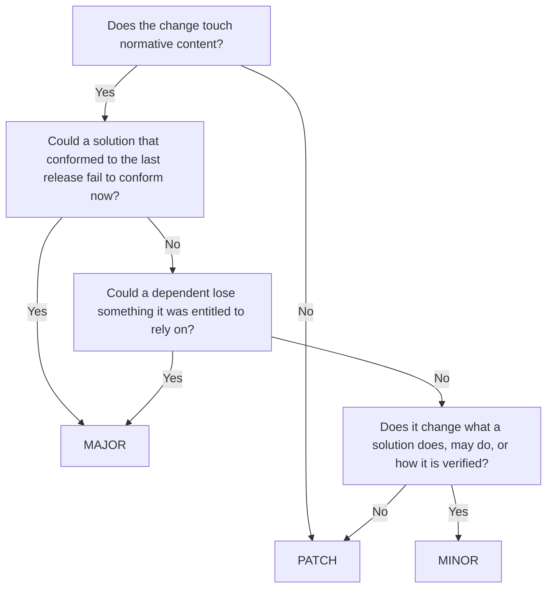

> **Proposal for discussion with the Architecture Working Group.** This chapter sets out how a Working Group decides whether a release of its specification is a major, minor or patch release, and how it documents what changed. It builds on `requirements/use_semantic_versioning.md` and `research/specification_versioning.md`, and departs from them in a few places, listed in [Departures from the current text](#departures-from-the-current-text). Where it depends on the requirement status model, it assumes Option 2 of ARCH-ADR-5. The questions the Working Group needs to settle are listed at the end.

GovStack versions its specifications with [Semantic Versioning](https://semver.org/). A version number has three parts, `MAJOR.MINOR.PATCH`, and each part tells a reader something different about what changed since the last release. The number is only useful if every Working Group reads a change the same way. Two Working Groups that make the same change to their specifications should arrive at the same kind of release. This chapter gives the rules that make that possible.

# The purpose of version numbers

## The unit of the version

The unit of the version number is the whole specification. Requirements are not versioned individually, so changing one requirement requires the group to release a new version of the specification that contains it, and the requirement is cited together with that version.

## What the version promises

Semantic Versioning was written for software, where the version number makes a promise about a public API. For a GovStack specification, the promise is about its **normative content**:

- every published requirement, with its statement and its classifiers
- the interfaces those requirements refer to, such as the operations and schemas in `resources/api.yml`
- the compliance tests derived from those requirements
- the specifications it extends, and the versions it extends them at

Everything else is **informative**: the overview, the scope, explanatory text, diagrams, examples and workflows that no requirement refers to. Informative content can change in any release, and on its own it only ever justifies a patch release.

The normative content binds two kinds of party, and within one major version the specification makes a promise to each:

| Party | Who they are | What the specification promises them within a major version |
|---|---|---|
| **Implementers** | Those who build solutions and claim conformance | A solution that conforms to an earlier version also conforms to every later version |
| **Dependents** | Those who rely on a conformant solution behaving as specified: the integrators who build services on top of a solution, the specifications that extend this one, the procurement documents and laws that cite its requirements, and GovMarket, which reports conformance to buyers | Anything they were entitled to rely on in an earlier version still holds in every later version |

A software API usually only has to protect its callers. A specification also has to protect implementers, because it describes what they must build, and they have no control over what it demands. A change that breaks **either** promise therefore starts a new major version. The three parts of the number then mean:

| Part | Meaning for implementers | Meaning for dependents |
|---|---|---|
| **MAJOR** | A conformant solution may no longer conform. Read the migration note | Something you relied on may have changed. Read the migration note |
| **MINOR** | Your solution still conforms. There are new or changed RECOMMENDED requirements, or announced deprecations, that you may want to act on | Nothing you relied on has changed. There may be new optional capabilities to look for |
| **PATCH** | Nothing to do | Nothing to do |

One consequence is worth stating plainly, because procurement depends on it: **within a major version, the set of REQUIRED obligations does not change.** Conformance to Wallet 2.0.0 and conformance to Wallet 2.7.3 are the same pass or fail result; the minor versions differ only in RECOMMENDED content, which affects the coverage GovMarket reports and not the conformance verdict. A buyer can therefore require "conformance to Wallet 2" and know what they are asking for.

# Deciding the release type

## The procedure

Before a release, the Working Group lists every change since the last released version and classifies each one using the rules in this section. The release takes the type of its most significant change: one breaking change makes the whole release a major release. When a part of the number increases, the parts to its right reset to zero, so a major release after 2.4.1 is 3.0.0.

Each change is classified by asking these questions in order:



The last question catches normative edits that change nothing a solution does: correcting a typo in a requirement statement, or fixing an example in `api.yml` that contradicted its schema. Those are patch changes even though they touch normative files.

When the Working Group is unsure which side of a line a change falls on, it takes the more significant release type. A minor release that turns out to break a solution costs more than a major release that turns out to have been unnecessary.

## Breaking changes

A change is **breaking** if it adds an obligation that a conformant solution may not meet, or removes or weakens a guarantee a dependent may rely on. Tightening and loosening are both breaking, because each one hurts a different side. Breaking changes include:

- **Adding a REQUIRED requirement.** Every solution that conformed before must now do something new
- **Promoting a requirement from RECOMMENDED to REQUIRED.** Solutions that did not implement it no longer conform
- **Demoting a requirement from REQUIRED to RECOMMENDED.** Solutions still conform, but a dependent that relied on every conformant solution offering the behaviour can no longer rely on it
- **Retiring a REQUIRED requirement** (`PUBLISHED` to `DEPRECATED`). For the same reason as demotion
- **Changing the intent of a REQUIRED requirement**, whether it narrows what a solution may do (implementers break) or broadens it (dependents break). "The solution returns credentials in JSON" changed to "in JSON or CBOR" is breaking: an integrator that only reads JSON stops working with some conformant solutions
- **Changing an interface a REQUIRED requirement refers to** in a way listed as breaking in [Interface changes](#interface-changes)
- **Restricting the mutability of a requirement**, such as `REPLACEABLE` to `EXTENSIBLE` or `EXTENSIBLE` to `IMMUTABLE`. Extending specifications that replaced or switched off the rule are no longer valid
- **Changing the intent of an `IMMUTABLE` requirement**, at any level. The requirements model already forbids this within a major version
- **Moving to a new major version of an extended specification**, such as a Building Block specification adopting a new major version of the cross-functional requirements
- **Reusing, renumbering or removing a requirement number.** The *Unique Identifier* rules forbid this outright, in any release type; it is listed here only because a specification that did it would break every citation of the number

## Non-breaking changes

A change is **non-breaking** if it changes normative content but keeps both promises. These are minor changes:

- **Adding a RECOMMENDED requirement.** No solution loses conformance, and no dependent could have relied on a requirement that did not exist
- **Changing the intent of a RECOMMENDED requirement.** Conformance is unaffected. GovMarket recomputes the coverage it reports, and the changelog says which solutions may be affected
- **Retiring a RECOMMENDED requirement.** Dependents could never rely on an optional requirement being met
- **Reinstating a deprecated requirement as RECOMMENDED**
- **Loosening the mutability of a requirement**, such as `IMMUTABLE` to `EXTENSIBLE` or `EXTENSIBLE` to `REPLACEABLE`. Every existing extending specification stays valid, and an extended rule must still pass its base behaviour, so dependents keep what they relied on
- **Changing how a requirement is verified** (`OBSERVABLE` to `AUDITABLE` or back) without changing what it demands. GovMarket re-verifies the requirement for solutions already listed, and the changelog says so. See question 4 at the end
- **Announcing a deprecation.** A requirement that will be retired in the next major version is marked as such in the changelog while it remains in force. See [Deprecate first, retire later](#deprecate-first-retire-later)
- **Changing an interface** in a way listed as non-breaking in [Interface changes](#interface-changes)
- **Moving to a new minor version of an extended specification**, since it brings in new RECOMMENDED requirements

## Patch changes

A **patch** change corrects the specification without changing what any solution does, may do, or how it is verified. Patch changes include:

- correcting spelling, grammar and formatting, in normative and informative text alike
- rewording a requirement statement for clarity, where every solution that met the old wording meets the new one and the other way round. If the rewording admits or excludes any behaviour, it is not a clarification, and it is classified as a change of intent
- correcting an example, diagram or description that contradicted the normative text, so that it agrees with it
- correcting a requirement's `type` (`FUNCTIONAL`, `WEBSERVICE`, `INTERFACE`) where the statement is unchanged
- adding, changing or withdrawing requirements that are not yet published (`DRAFT`, `CANDIDATE`, `ACCEPTED`, `WITHDRAWN`). They take no part in conformance. See question 6 at the end
- changing informative content: the overview, the scope, terminology, references, explanatory text
- updating a link or a reference to an external document, where the version of the external document the specification relies on does not change. Moving to a different version of a referenced standard is classified by its effect, like any other change
- moving to a new patch version of an extended specification

## Classifier changes

The requirements model says that any change to a classifier requires a new version. This table says which one.

| Classifier | Change | Release |
|---|---|---|
| `level` | `RECOMMENDED` → `REQUIRED` | MAJOR |
| `level` | `REQUIRED` → `RECOMMENDED` | MAJOR |
| `status` | → `PUBLISHED` (a new requirement released), with `level: REQUIRED` | MAJOR |
| `status` | → `PUBLISHED` (a new requirement released), with `level: RECOMMENDED` | MINOR |
| `status` | `PUBLISHED` → `DEPRECATED`, with `level: REQUIRED` | MAJOR |
| `status` | `PUBLISHED` → `DEPRECATED`, with `level: RECOMMENDED` | MINOR |
| `status` | `DEPRECATED` → `PUBLISHED` | as for a new requirement of the same `level` |
| `status` | any change between `DRAFT`, `CANDIDATE`, `ACCEPTED` and `WITHDRAWN` | PATCH |
| `mutability` | towards more restrictive (`REPLACEABLE` → `EXTENSIBLE` → `IMMUTABLE`) | MAJOR |
| `mutability` | towards less restrictive (`IMMUTABLE` → `EXTENSIBLE` → `REPLACEABLE`) | MINOR |
| `observability` | `OBSERVABLE` ↔ `AUDITABLE`, demand unchanged | MINOR |
| `type` | corrected, statement unchanged | PATCH |

A requirement with no explicit classifier takes the default the requirements model gives it. Writing the default explicitly is not a change.

## Interface changes

Interfaces in `resources/api.yml` are part of the normative content when a requirement refers to them. Because a specification binds both sides, an interface change has to be checked twice: against solutions that implement the interface, and against clients that call it. The rules below apply to interfaces referred to by a REQUIRED requirement. Changes to interfaces referred to only by RECOMMENDED requirements are minor, unless the interface is also used by a REQUIRED one.

| Change | Release | Why |
|---|---|---|
| Add an operation | as for the requirement that introduces it | |
| Remove or rename an operation, path, parameter or field | MAJOR | clients break |
| Change the type or format of a field | MAJOR | both sides break |
| Add a request field that solutions must act on | MAJOR | existing solutions ignore it |
| Add an optional request field that solutions may ignore | MINOR | |
| Make an optional request field required | MAJOR | existing clients do not send it |
| Make a required request field optional | MAJOR | existing solutions may reject requests without it |
| Add a response field that solutions must return | MAJOR | existing solutions do not return it |
| Add an optional response field | MINOR, if clients are required to ignore fields they do not know; otherwise MAJOR | |
| Make a required response field optional | MAJOR | clients that read it break |
| Add a value to a value set the solution must accept | MAJOR | existing solutions reject it |
| Add a value to a value set the solution may return | MINOR, if the value set is declared open; otherwise MAJOR | clients that only handle the listed values break |
| Tighten validation of a request (pattern, length, range) | MAJOR | existing clients may send values now rejected |
| Loosen validation of a request | MAJOR | existing solutions may reject values now allowed |
| Correct a description, summary or example to match the schema | PATCH | |

Two of these rows depend on a rule the specification may or may not state: that clients ignore response fields they do not know, and that a value set is open to new values. Stating these rules in the first major version of a specification turns several later breaking changes into minor ones. See question 3 at the end.

## Compliance tests

Tests are derived from requirements, and the requirement text governs. A test is never the place to change what a specification demands.

- **Correcting a test so that it agrees with its requirement** is a patch change. If the correction makes a solution fail that used to pass, that solution never met the requirement, but the changelog must say so in plain terms, because its listing on GovMarket may change
- **Adding a test for a requirement that had none** is a patch change, on the same reasoning
- **A test that cannot be made to agree with its requirement** means the requirement is wrong. The requirement is changed, and the change is classified as a change to the requirement

## Extended specifications

Every Building Block specification extends the cross-functional requirements, and a specification can itself be extended by a profile. An extending specification names the version of each specification it extends, and moving to another version is a change to its own normative content:

| The extended specification releases | The extending specification, when it adopts that release |
|---|---|
| a patch | releases at least a patch |
| a minor | releases at least a minor |
| a major | releases a major |

An extending specification is not forced to adopt a new release of what it extends. It keeps extending the version it names until it chooses to move, and its own version number tells its readers when it does. A new major version of the cross-functional requirements therefore does not break any Building Block specification on the day it is released; it breaks each one on the day that Building Block adopts it.

# Managing breaking changes

Under these rules, any change to a REQUIRED obligation is a major release. That is deliberate: it is what lets a buyer cite "Wallet 2" and know what they get. It also means Working Groups need a way to evolve a specification without releasing a new major version for every improvement. Three practices provide it.

## Recommend first, require later

A new obligation enters the specification as a RECOMMENDED requirement in a minor release. Implementers can adopt it, GovMarket reports who has, and the Working Group learns whether it is practical. In the next major release the Working Group promotes it to REQUIRED, with evidence that solutions can meet it. Requirements written this way are rarely reworked after they become mandatory.

## Deprecate first, retire later

A REQUIRED requirement that the Working Group intends to retire is announced in a minor release, under **Deprecated** in the changelog, with the major version in which it will be retired and what replaces it, if anything. The requirement stays in force, and its status stays `PUBLISHED`, until that major release changes it to `DEPRECATED`. Dependents get at least one minor release of warning before a guarantee they rely on disappears.

## Batch breaking changes

Each major release costs every implementer and every dependent a migration. A Working Group should collect breaking changes and release them together, rather than releasing a major version for each. See question 5 at the end.

## Pre-releases and initial development

- **Pre-releases** carry a suffix: `3.0.0-draft.1` for a working draft open to comment, `3.0.0-rc.1` for a release candidate. A pre-release makes no promise, and no solution can claim conformance to one. The `1.0-draft` currently in this specification's `metadata.yml` is not a valid version under this scheme, and would become `1.0.0-draft.1`
- **Versions below 1.0.0** mark a specification in initial development. Semantic Versioning makes no compatibility promise below 1.0.0, and neither does GovStack. A specification should reach 1.0.0 before GovMarket lists conformance against it
- **Legacy versions** in the `YYQN` scheme are not compared with semantic versions. The first semantic version of a legacy specification is a major release, as `requirements/use_semantic_versioning.md` already provides

## Released versions never change

Once released, a version's content is fixed. A mistake found after release is corrected in a new release, classified by the rules above, never by editing the released version.

# Documenting changes

A version number says how much changed. The documentation says what changed, why, and what to do about it. Every release has a changelog entry, every major release has a migration note, and every significant decision has an architecture decision record.

## The changelog

Each specification keeps a `CHANGELOG.md` at the root of its repository, in the [Keep a Changelog](https://keepachangelog.com/en/1.1.0/) format. The newest release comes first, and changes merged but not yet released are collected under an `Unreleased` heading, so that the release type can be read off the changelog when the release is prepared.

Keep a Changelog groups changes under six headings. Each heading has a natural release type, which serves as a check on the classification:

| Heading | Holds | Usual release type |
|---|---|---|
| **Added** | new published requirements, operations, fields | MAJOR if REQUIRED, MINOR if RECOMMENDED |
| **Changed** | changes to the intent, classifiers or interfaces of published requirements | as classified above |
| **Deprecated** | announced retirements of requirements still in force | MINOR |
| **Removed** | requirements retired (`PUBLISHED` → `DEPRECATED`) | MAJOR if REQUIRED, MINOR if RECOMMENDED |
| **Fixed** | clarifications, corrected examples, corrected tests | PATCH |
| **Security** | changes made to address a vulnerability in what the specification demands | as classified above |

Each entry:

- names the requirement or interface it affects, by its number or operation identifier, so that the entry can be traced and checked against the compiler's diff
- states the `level` of an affected requirement, so a reader can see at a glance whether conformance is affected
- starts with **BREAKING:** if the change is breaking, so a major release explains itself
- links the pull request or decision record behind the change
- is written for an implementer or a buyer, not for the Working Group: what changed and what it means, not how the text was edited

Changes to informative content can be summarised in one entry, such as "Rewrote the overview". Changes to unpublished requirements are not listed until they are published.

An illustrative example, for a fictitious release of the Wallet specification:

```markdown
## [Unreleased]

## [2.1.0] - 2026-11-30

### Added
- req-23 (RECOMMENDED): the solution exports a holder's credentials in a portable format. Will be proposed as REQUIRED in 3.0.0. (#142)

### Changed
- req-15 (RECOMMENDED): the backup must now be encrypted at rest. Solutions with unencrypted backups lose coverage for req-15 on GovMarket. (#139)
- `listCredentials` operation: added the optional response field `expiresAt`. Clients ignore fields they do not know. (#140)

### Deprecated
- req-7 (REQUIRED): the proprietary export endpoint. Will be retired in 3.0.0 and replaced by req-23. (#142)

### Fixed
- req-12 (REQUIRED): the example response contradicted the schema and has been corrected. (#137)
- Test for req-9 now checks the status code the requirement names. Solutions that returned 200 instead of 201 will now fail it. (#138)
```

## Migration notes

Every major release comes with a migration note, written for implementers and dependents, published with the release. It lists:

- every breaking change, with the requirement numbers and interfaces it affects
- the compliance tests that were added, changed or removed, so a vendor can tell which results will move
- for each breaking change, what an implementer must do, and what a dependent must do, to move to the new version
- the versions of extended specifications the release adopts

The migration note is not a replacement for the changelog entry; the changelog says what changed, the migration note says how to follow.

## Decision records

A breaking change is a decision with consequences for other parties, and the reasoning should outlive the pull request. Each breaking change, and each deprecation announcement, cites an architecture decision record in `ADR/`, or a decision recorded by the Working Group, that explains why the change was worth its cost. The changelog links it; it does not restate it.

## Release metadata

The version itself is recorded in `metadata.yml`, with the release date and a short description. The short description summarises the release in one sentence for listings, such as GovMarket and the specification index, and links the changelog for detail. It names the release type when it is a major release.

# Checking the release type

The rules in this chapter are mechanical enough that most of them can be checked. The GovStack compiler already compares every release with the last released version to enforce the *Unique Identifier* rules. The same comparison can compute the **minimum** release type: a new REQUIRED requirement, a changed `level` or a removed operation each set a floor. The Working Group may release a more significant version than the compiler computes, never a less significant one.

Changes of intent in a statement cannot be detected by a comparison. The compiler reports every changed statement, as it already does for `IMMUTABLE` requirements, and the release review confirms each one as a clarification (patch) or a change of intent (classified by `level`).

# Departures from the current text

This proposal departs from `requirements/use_semantic_versioning.md` and `research/specification_versioning.md` in these places:

| The current text says | This proposal says | Why |
|---|---|---|
| A minor increment can add new "OPTIONAL or RECOMMENDED rules" | A minor increment can add RECOMMENDED requirements, and states that adding a REQUIRED requirement is major | `OPTIONAL` is not a classifier, and the current text does not say what adding a REQUIRED rule is |
| "Extensions to an existing enumerated value set" are minor | It depends on whether the solution accepts or returns the values, and whether the set is declared open | A new value a solution must accept breaks existing solutions; a new value it may return breaks existing clients |
| "Clarifications that broaden but do not narrow acceptable behaviour" are minor | Broadening the intent of a REQUIRED requirement is major | Broadening breaks dependents, who could rely on the narrower behaviour from every conformant solution |
| Patches "update references to external standards" | Updating a link is a patch; moving to another version of a standard is classified by its effect | A new version of a referenced standard can change what a solution must do |
| Any classifier change requires a version bump | Each classifier change has a defined release type | So that two Working Groups make the same call |
| (not addressed) | Within a major version, the set of REQUIRED obligations is fixed | It follows from the two promises, and is what procurement needs |

# Questions for the Architecture Working Group

1. **Two-sided compatibility.** This proposal treats a change as breaking if it hurts implementers *or* dependents, so relaxing a REQUIRED obligation is a major change. The alternative is to protect implementers only: a solution that conformed keeps conforming, and relaxations become minor. That gives fewer major releases, but conformance to "Wallet 2" would then mean different things in different minor versions. Which does the Working Group want?
2. **New REQUIRED requirements.** Is the Working Group prepared to treat every new REQUIRED requirement as a major release, relying on *recommend first, require later* to keep major releases rare?
3. **Tolerant clients and open value sets.** Should the cross-functional requirements oblige every client to ignore response fields it does not recognise, and should value sets be open by default? Either would turn several breaking interface changes into minor ones, across every Building Block.
4. **Observability changes.** Moving a requirement from `OBSERVABLE` to `AUDITABLE` does not change what a solution must do, but it changes the evidence a vendor must produce. Is that minor, as proposed, or major?
5. **Release cadence.** Should there be a minimum interval between major releases of a specification, or a minimum number of minor releases between a deprecation announcement and the retirement?
6. **Unpublished requirements in releases.** Under ARCH-ADR-5, a release may contain `DRAFT` or `CANDIDATE` requirements to invite experimentation. This proposal treats changes to them as patch changes. Should introducing a significant body of draft requirements be signalled with a minor release instead?
7. **Changes to RECOMMENDED requirements.** Changing the intent of a RECOMMENDED requirement is minor here, because conformance is unaffected. An integrator that relies on a particular solution implementing it is still affected. Is the changelog warning enough, or should these be major too?
8. **Where the changelog lives.** This proposal places `CHANGELOG.md` at the repository root. The repository outline in `chapters/structure_of_specifications.md` would need to include it, and `requirements/keeping_changelog.md` would carry the rule as a requirement of this specification.
