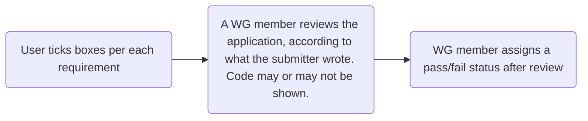

# Meta-Specification
Specification Framework, Terminologies, and Scripts for supporting the GovStack Specification Ecosystem

---

### Big Why: Make Compliance to our Specifications meaningful 

- Up untill now, Compliance Assessment is self-assesed
- No concrete code testing is submitted

- Specifications need to support the Compliance process