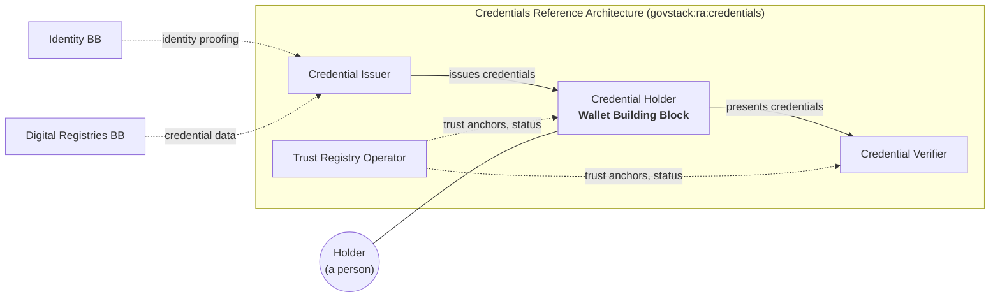
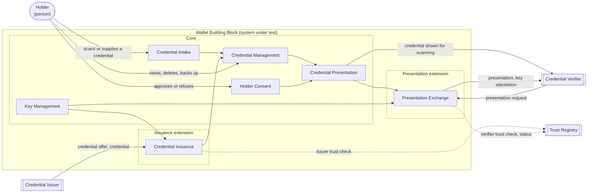

<!-- Worked example for chapters/introductory_chapters.md. Illustrative: the Credentials Reference Architecture (govstack:ra:credentials) and the requirement file names are examples, not published artefacts. -->

# Overview

## Purpose

### Value

The Wallet Building Block exists so that a person can hold the credentials issued to them, and present them to anyone who needs to check them, without the issuer and the checking party having to integrate with each other.

Today a licence, a qualification or an entitlement is issued by one system and checked by others, each in its own way. A person proves the same fact again and again, on paper or through a portal, and every institution that accepts a credential builds a new integration with every institution that issues one. The Wallet provides **Credential Custody**, **Selective Disclosure** and **Holder Control**, so that a credential issued once can be presented anywhere it is accepted, and the person decides what is shared each time.

A common specification matters here for two reasons. The first is **choice**: a person chooses their own wallet, and a government cannot require every resident to use the same software. Unless every wallet behaves the same way at its interfaces, every verifier must support every wallet product separately. The second is **interoperability**: issuers, holders and verifiers are run by parties that do not control each other's systems, and they can only work together through an agreed exchange.

### Place in larger systems

The Wallet operates within the GovStack Architecture, and every conformant Wallet meets the GovStack cross-functional requirements.

In the Credentials Reference Architecture (`govstack:ra:credentials`) the Wallet performs the **Credential Holder** role. Every conformant Wallet holds and presents credentials. The exchanges with Issuers and Verifiers that the role involves are in two extensions, Issuance and Presentation, so only a Wallet that claims them performs the role in full. Three other roles complete the system: the **Credential Issuer**, which issues credentials; the **Credential Verifier**, which requests and checks them; and the **Trust Registry Operator**, which publishes the trust anchors and status information that let the Holder and the Verifier decide whether to trust an Issuer and whether a credential is still valid.

The Wallet is a feature Building Block: no other Building Block depends on it. It commonly works with:

- the **Identity** Building Block, whose identity proofing an Issuer relies on before issuing a credential to a person;
- the **Digital Registries** Building Block, which commonly holds the data an Issuer puts into a credential.

Neither exchanges information with the Wallet directly. Both sit behind the Issuer.

*Figure 1: the Wallet in the Credential Holder role.*

## Description

### System under test

The system under test is a software component that holds credentials on behalf of one person, together with the keys bound to them, and presents them at that person's direction.

Its boundary includes everything the person installs or is provided with to hold and present credentials: the application they interact with and any service it relies on to store credentials or keys on their behalf. It excludes the systems of Issuers, Verifiers and trust registries, even when a single organisation provides both a wallet and an issuing service.

The Wallet is assessed as a black box. Every functionality is observable through an exchange with an emulated Issuer or Verifier, or through the user interface. Key protection and the deletion of stored credentials cannot be fully observed from outside, and the requirements that cover them are verified by audit.

### Functionalities

| Functionality | Realises | Conformance | Description | Requirements |
|---|---|---|---|---|
| Credential Intake | Credential Custody | Core | Receiving a credential the Holder supplies, such as a signed code printed on a certificate, a file or a link, recognising its format, and checking it before it is stored | `requirements/credential-intake.md` |
| Credential Management | Credential Custody, Holder Control | Core | Keeping credentials across sessions and devices, showing them to the Holder, and deleting, backing up and recovering them | `requirements/credential-management.md` |
| Key Management | Selective Disclosure | Core | Generating, protecting and rotating the keys bound to credentials, and attesting to them when asked | `requirements/key-management.md` |
| Holder Consent | Holder Control | Core | Showing the Holder who is asking for what, and recording their decision before anything is disclosed | `requirements/holder-consent.md` |
| Credential Presentation | Selective Disclosure | Core | Presenting a credential with only the attributes the Holder agreed to disclose, at least by showing it for a Verifier to scan | `requirements/credential-presentation.md` |
| Credential Issuance | Credential Custody | Issuance extension | Obtaining credentials from a Credential Issuer through the issuance exchange, started by an offer the Holder scans or follows | `requirements/credential-issuance.md` |
| Presentation Exchange | Selective Disclosure | Presentation extension | Answering a Credential Verifier's request, remotely or in proximity, through the presentation exchange, with proof that the credential is bound to the Holder | `requirements/presentation-exchange.md` |

Every capability is realised by at least one core functionality, so every conformant Wallet provides all three. **Credential Custody** is divided between taking credentials in (Credential Intake, and Credential Issuance in the Issuance extension) and keeping them (Credential Management). **Selective Disclosure** rests on Key Management, which binds a credential to its Holder, and on Credential Presentation; the Presentation extension adds remote presentation with proof of that binding. **Holder Control** is Holder Consent, together with the Holder's power to delete credentials in Credential Management.

#### Core and extensions

The core is what makes a product a Wallet: it holds credentials signed by an issuer other than the Holder, protects them and the keys bound to them, and presents them at the Holder's direction. A Wallet that meets only the core can take in a credential the Holder supplies and show it to a Verifier for scanning, with no Issuer or Verifier following any particular protocol. A product that holds keys but no issued credential, such as a crypto hardware wallet, does not meet the core.

| Extension | Adds | Functionalities | Role served | Requires |
|---|---|---|---|---|
| Issuance | Obtaining credentials from an Issuer, instead of only from the Holder | Credential Issuance | Credential Holder, towards the Credential Issuer, in `govstack:ra:credentials` | |
| Presentation | Answering a Verifier's request remotely or in proximity, with holder binding | Presentation Exchange | Credential Holder, towards the Credential Verifier, in `govstack:ra:credentials` | |

Both exchanges are extensions because they are obligations towards roles of the credentials domain, and they depend on a trust registry that not every deployment operates. A Wallet built for a credentials ecosystem claims both. A Wallet that imports credentials from printed codes and presents them to online services claims Presentation only.

Three functionalities a reader might expect are placed elsewhere: issuing credentials belongs to the Issuer, operating a trust registry to the Trust Registry Operator, and managing an organisation's records of consent to process personal data to the Consent Building Block. See the scope for their owners.

*Figure 2: functionality map, with the core and two extensions.*

### Actors

| Actor | Kind | Boundary | Reaches the Wallet through | Specified where |
|---|---|---|---|---|
| Holder | Person | Outside | Credential Intake, Credential Management, Holder Consent | Not specified: a person is not assessed. The user interface is specified here |
| Credential Issuer | System | Outside | Credential Issuance (Issuance extension) | `govstack:ra:credentials` |
| Credential Verifier | System | Outside | Credential Presentation; Presentation Exchange (Presentation extension) | `govstack:ra:credentials` |
| Trust Registry | System | Outside | Credential Issuance, Presentation Exchange | `govstack:ra:credentials` |

### Interfaces

| Interface | Counterpart | Direction | Functionality | Type | Contract defined in |
|---|---|---|---|---|---|
| Credential issuance | Credential Issuer | Inbound offer and credential, outbound request | Credential Issuance | Protocol | `govstack:ra:credentials`, realised by `requirements/credential-issuance.md` |
| Credential carrier | Holder | Inbound | Credential Intake | Device: camera, file, link | This specification, `requirements/credential-intake.md` |
| Credential display | Credential Verifier | Outbound | Credential Presentation | Device: screen | This specification, `requirements/credential-presentation.md` |
| Presentation exchange | Credential Verifier | Inbound request, outbound presentation | Presentation Exchange, Key Management | Protocol | `govstack:ra:credentials`, realised by `requirements/presentation-exchange.md` |
| Trust and status lookup | Trust Registry | Outbound | Credential Issuance, Presentation Exchange | Service | `govstack:ra:credentials` |
| Consent prompt | Holder | Outbound prompt, inbound decision | Holder Consent | User interface | This specification, `requirements/holder-consent.md` |
| Credential management | Holder | Both | Credential Management | User interface | This specification, `requirements/credential-management.md` |

The Wallet exposes no Service API of its own to other Building Blocks. Logging, monitoring and deployment interfaces are inherited from the cross-functional requirements and are not listed.
