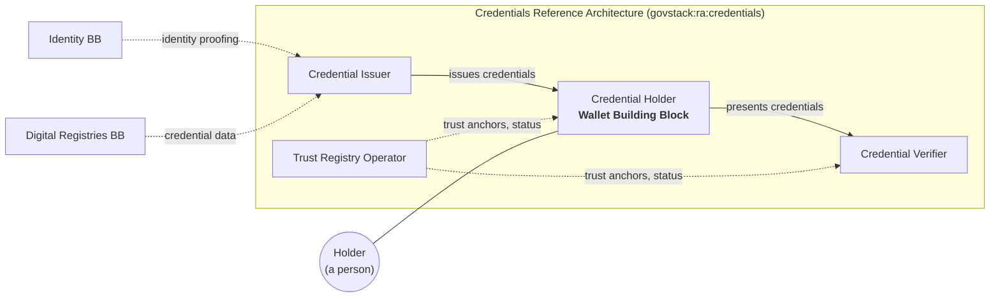

<!-- Worked example for chapters/introductory_chapters.md. Illustrative: the Credentials Reference Architecture (govstack:ra:credentials) and the requirement file names are examples, not published artefacts. -->

# Purpose

## Value

The Wallet Building Block exists so that a person can hold the credentials issued to them, and present them to anyone who needs to check them, without the issuer and the checking party having to integrate with each other.

Today a licence, a qualification or an entitlement is issued by one system and checked by others, each in its own way. A person proves the same fact again and again, on paper or through a portal, and every institution that accepts a credential builds a new integration with every institution that issues one. The Wallet provides **Credential Custody**, **Selective Disclosure** and **Holder Control**, so that a credential issued once can be presented anywhere it is accepted, and the person decides what is shared each time.

A common specification matters here for two reasons. The first is **choice**: a person chooses their own wallet, and a government cannot require every resident to use the same software. Unless every wallet behaves the same way at its interfaces, every verifier must support every wallet product separately. The second is **interoperability**: issuers, holders and verifiers are run by parties that do not control each other's systems, and they can only work together through an agreed exchange.

## Place in larger systems

The Wallet operates within the GovStack Architecture, and every conformant Wallet meets the GovStack cross-functional requirements.

In the Credentials Reference Architecture (`govstack:ra:credentials`) the Wallet performs the **Credential Holder** role. Every conformant Wallet holds and presents credentials. The exchanges with Issuers and Verifiers that the role involves are in two extensions, Issuance and Presentation, so only a Wallet that claims them performs the role in full. Three other roles complete the system: the **Credential Issuer**, which issues credentials; the **Credential Verifier**, which requests and checks them; and the **Trust Registry Operator**, which publishes the trust anchors and status information that let the Holder and the Verifier decide whether to trust an Issuer and whether a credential is still valid.

The Wallet is a feature Building Block: no other Building Block depends on it. It commonly works with:

- the **Identity** Building Block, whose identity proofing an Issuer relies on before issuing a credential to a person;
- the **Digital Registries** Building Block, which commonly holds the data an Issuer puts into a credential.

Neither exchanges information with the Wallet directly. Both sit behind the Issuer.

*Figure 1: the Wallet in the Credential Holder role.*
