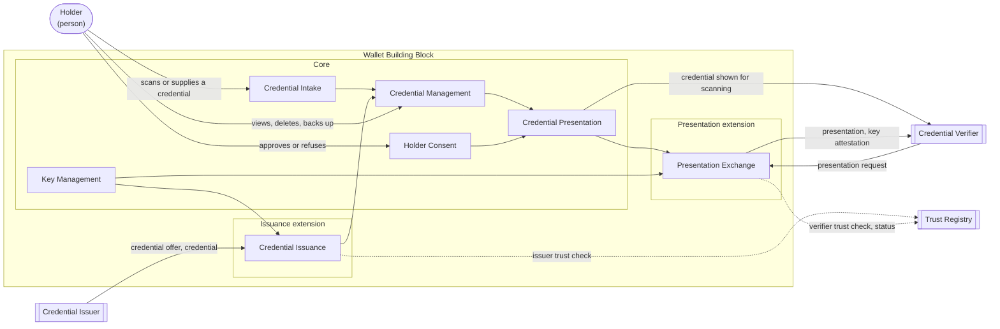

<!-- Worked example for chapters/introductory_chapters.md. Illustrative: the Credentials Reference Architecture (govstack:ra:credentials) and the requirement file names are examples, not published artefacts. -->

# Technical Overview

## Market assessment

The Working Group surveyed three kinds of software that hold credentials for a person: national and regional identity wallets, such as those built under the European Digital Identity framework; single-purpose applications that hold one kind of credential, such as mobile driving licences and the health certificate applications deployed during the COVID-19 pandemic; and general-purpose verifiable credential wallets from open-source projects. It also reviewed the previous version of this specification, `govstack:spec:bb:wallet` 1.2.

It examined the standards and protocols these systems use: the W3C Verifiable Credentials Data Model and SD-JWT VC for credential formats and selective disclosure, ISO/IEC 18013-5 for presentation in proximity, and OpenID for Verifiable Credential Issuance and OpenID for Verifiable Presentations for remote exchanges.

Every system surveyed takes credentials in, keeps them and the keys bound to them, asks the Holder before disclosing anything, and presents what the Holder agreed to. These became the core functionalities. The systems differ most in how they obtain credentials and how they answer Verifiers. A health certificate application imports a signed code and shows it for scanning, with no protocol between it and the Issuer or Verifier; an identity wallet runs full issuance and presentation exchanges. That difference is why Credential Issuance and Presentation Exchange are extensions. Several protocols compete for each exchange, so this specification leaves the choice of protocol to `govstack:ra:credentials` and specifies only the Wallet's side of it.

The survey also drew the edges of the Building Block. Hardware wallets for cryptocurrency keys hold keys but no credential issued by someone else, so key custody on its own does not make a Wallet. Three functionalities that some surveyed systems bundle with a wallet are placed elsewhere: issuing credentials belongs to the Issuer, operating a trust registry to the Trust Registry Operator, and managing an organisation's records of consent to process personal data to the Consent Building Block. The scope names their owners.

## Functionalities

| Functionality | Realises | Conformance | Description | Requirements |
|---|---|---|---|---|
| Credential Intake | Credential Custody | Core | Receiving a credential the Holder supplies, such as a signed code printed on a certificate, a file or a link, recognising its format, and checking it before it is stored | `requirements/credential-intake.md` |
| Credential Management | Credential Custody, Holder Control | Core | Keeping credentials across sessions and devices, showing them to the Holder, and deleting, backing up and recovering them | `requirements/credential-management.md` |
| Key Management | Selective Disclosure | Core | Generating, protecting and rotating the keys bound to credentials, and attesting to them when asked | `requirements/key-management.md` |
| Holder Consent | Holder Control | Core | Showing the Holder who is asking for what, and recording their decision before anything is disclosed | `requirements/holder-consent.md` |
| Credential Presentation | Selective Disclosure | Core | Presenting a credential with only the attributes the Holder agreed to disclose, at least by showing it for a Verifier to scan | `requirements/credential-presentation.md` |
| Credential Issuance | Credential Custody | Issuance extension | Obtaining credentials from a Credential Issuer through the issuance exchange, started by an offer the Holder scans or follows | `requirements/credential-issuance.md` |
| Presentation Exchange | Selective Disclosure | Presentation extension | Answering a Credential Verifier's request, remotely or in proximity, through the presentation exchange, with proof that the credential is bound to the Holder | `requirements/presentation-exchange.md` |

Every capability is realised by at least one core functionality, so every conformant Wallet provides all three. **Credential Custody** is divided between taking credentials in (Credential Intake, and Credential Issuance in the Issuance extension) and keeping them (Credential Management). **Selective Disclosure** rests on Key Management, which binds a credential to its Holder, and on Credential Presentation; the Presentation extension adds remote presentation with proof of that binding. **Holder Control** is Holder Consent, together with the Holder's power to delete credentials in Credential Management.

### Core and extensions

The core is what makes a product a Wallet: it holds credentials signed by an issuer other than the Holder, protects them and the keys bound to them, and presents them at the Holder's direction. A Wallet that meets only the core can take in a credential the Holder supplies and show it to a Verifier for scanning, with no Issuer or Verifier following any particular protocol. A product that holds keys but no issued credential, such as a crypto hardware wallet, does not meet the core.

| Extension | Adds | Functionalities | Role served | Requires |
|---|---|---|---|---|
| Issuance | Obtaining credentials from an Issuer, instead of only from the Holder | Credential Issuance | Credential Holder, towards the Credential Issuer, in `govstack:ra:credentials` | |
| Presentation | Answering a Verifier's request remotely or in proximity, with holder binding | Presentation Exchange | Credential Holder, towards the Credential Verifier, in `govstack:ra:credentials` | |

Both exchanges are extensions because they are obligations towards roles of the credentials domain, and they depend on a trust registry that not every deployment operates. A Wallet built for a credentials ecosystem claims both. A Wallet that imports credentials from printed codes and presents them to online services claims Presentation only.

*Figure 1: functionality map, with the core and two extensions.*

## Actors

| Actor | Kind | Boundary | Reaches the Wallet through | Specified where |
|---|---|---|---|---|
| Holder | Person | Outside | Credential Intake, Credential Management, Holder Consent | Not specified: a person is not assessed. The user interface is specified here |
| Credential Issuer | System | Outside | Credential Issuance (Issuance extension) | `govstack:ra:credentials` |
| Credential Verifier | System | Outside | Credential Presentation; Presentation Exchange (Presentation extension) | `govstack:ra:credentials` |
| Trust Registry | System | Outside | Credential Issuance, Presentation Exchange | `govstack:ra:credentials` |

## Interfaces

| Interface | Counterpart | Direction | Functionality | Type | Contract defined in |
|---|---|---|---|---|---|
| Credential issuance | Credential Issuer | Inbound offer and credential, outbound request | Credential Issuance | Protocol | `govstack:ra:credentials`, realised by `requirements/credential-issuance.md` |
| Credential carrier | Holder | Inbound | Credential Intake | Device: camera, file, link | This specification, `requirements/credential-intake.md` |
| Credential display | Credential Verifier | Outbound | Credential Presentation | Device: screen | This specification, `requirements/credential-presentation.md` |
| Presentation exchange | Credential Verifier | Inbound request, outbound presentation | Presentation Exchange, Key Management | Protocol | `govstack:ra:credentials`, realised by `requirements/presentation-exchange.md` |
| Trust and status lookup | Trust Registry | Outbound | Credential Issuance, Presentation Exchange | Service | `govstack:ra:credentials` |
| Consent prompt | Holder | Outbound prompt, inbound decision | Holder Consent | User interface | This specification, `requirements/holder-consent.md` |
| Credential management | Holder | Both | Credential Management | User interface | This specification, `requirements/credential-management.md` |

The Wallet exposes no Service API of its own to other Building Blocks. Logging, monitoring and deployment interfaces are inherited from the cross-functional requirements and are not listed.
